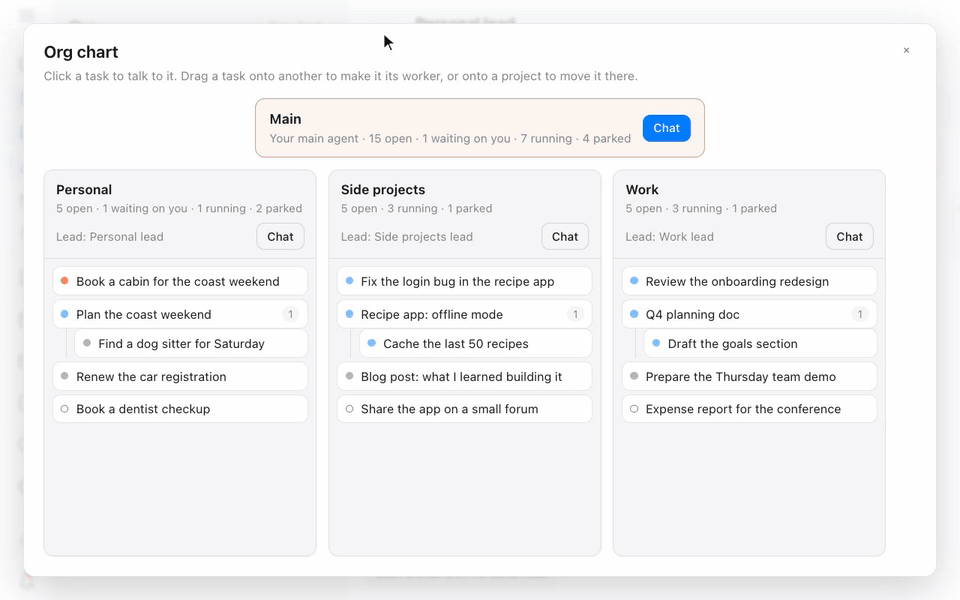
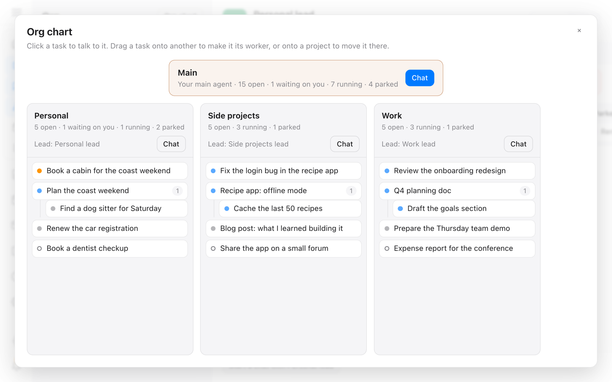
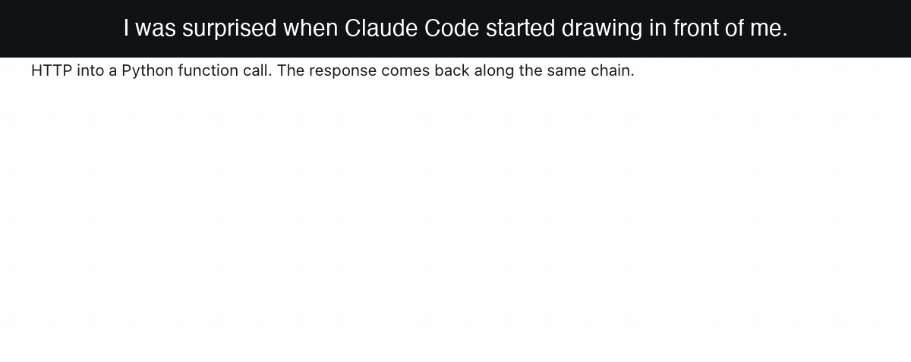
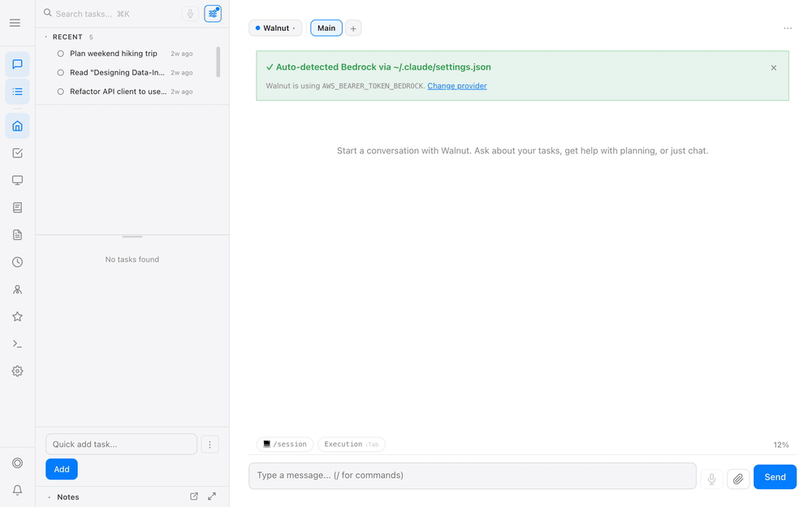
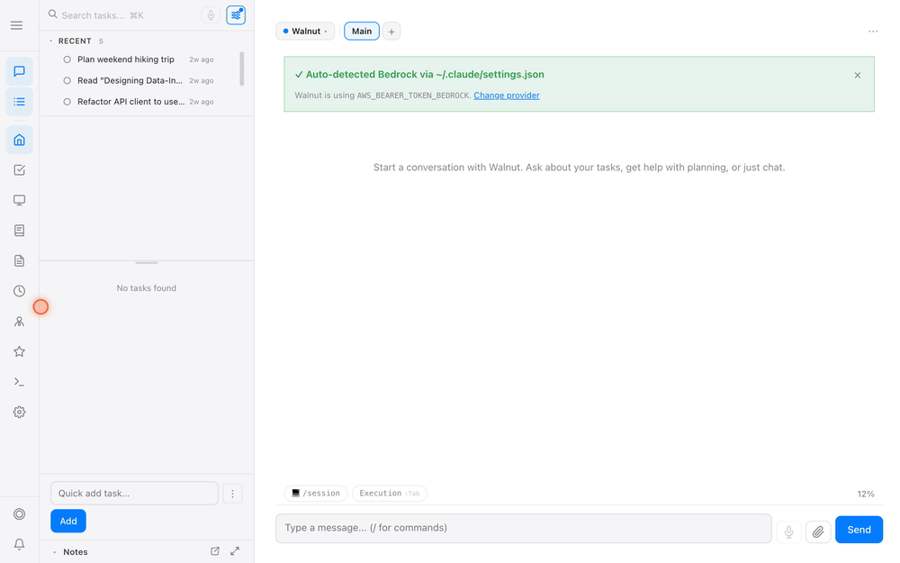
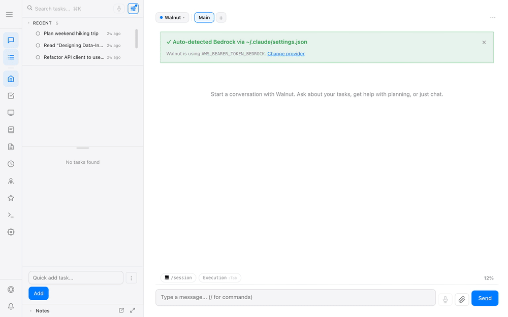
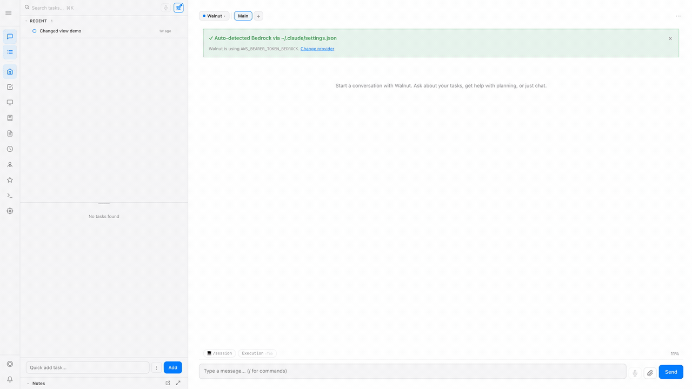
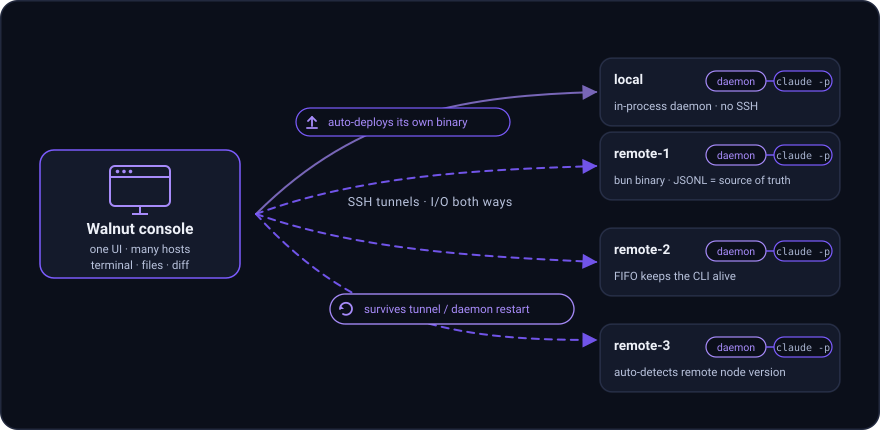
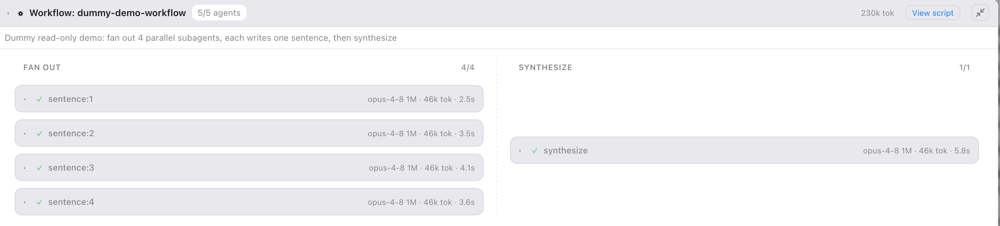
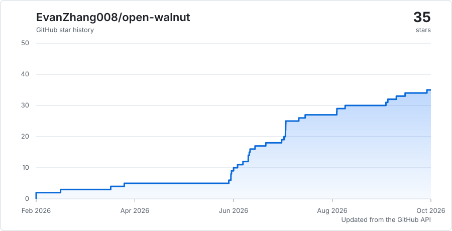

# Open Walnut

[](LICENSE)
[](https://github.com/EvanZhang008/open-walnut/actions)
[](https://bun.sh/)
[](https://www.typescriptlang.org/)
[](https://github.com/EvanZhang008/open-walnut)

**Replace Notion and your Claude Code terminals with one open-source app where AI agents
run your work like a small company.** You talk to one CEO agent (Main, in the app), and
each project gets its own lead that runs Claude Code sessions and workers for it.

Install on macOS or Linux with one line (it needs nothing else, not even Node), then open
[localhost:3456](http://localhost:3456):

```bash
curl -fsSL https://github.com/EvanZhang008/open-walnut/releases/latest/download/install.sh | sh
~/.local/bin/walnut web
```

Or with Homebrew, `brew install evanzhang008/tap/open-walnut && walnut web`, or get the Mac app:
[Apple silicon](https://github.com/EvanZhang008/open-walnut/releases/latest/download/Walnut-arm64.dmg) ·
[Intel](https://github.com/EvanZhang008/open-walnut/releases/latest/download/Walnut-x64.dmg).
Walnut runs its agents on [Claude Code](https://docs.anthropic.com/en/docs/claude-code), signed in once.



<p align="center"><sub><b>USED BY ENGINEERS AT</b></sub></p>
<p align="center">
  <picture>
    <source media="(prefers-color-scheme: dark)" srcset="docs/assets/logo-amazon-white.svg" />
    
  </picture>
  &nbsp;&nbsp;&nbsp;&nbsp;&nbsp;&nbsp;
  <picture>
    <source media="(prefers-color-scheme: dark)" srcset="docs/assets/logo-doordash-white.svg" />
    
  </picture>
</p>

Next to the org sit your tasks, Markdown notes, calendar, and long-term memory, and every
coding session in one web page: Claude Code, Codex, Gemini, OpenCode, and Goose, on your
laptop or on a remote dev box over SSH. Plugins add your own apps. Open Walnut is
self-hosted, local-first, MIT licensed, and has no telemetry.

## What Open Walnut Does

- **An org that runs your work**: Main, your CEO agent, sees every project. Each project
  has a lead that plans the work and hands it to workers, each one its own Claude Code
  session. The Org page shows what needs you, and you answer right where the question
  waits.
- **Personal AI**: Ask Walnut to manage tasks, find information, write and search
  notes, start coding sessions, and run scheduled routines.
- **Claude Code workspace**: Run and monitor multiple Claude Code sessions side by side
  with live output, permission controls, terminals, files, and session history.
- **Local and remote sessions**: Use the same web app for sessions on your laptop and
  any configured SSH host.
- **Durable sessions**: Sessions keep running across browser disconnects, dropped SSH
  connections, and Walnut server restarts.
- **Every coding agent**: Claude Code by default, and Codex, Gemini, OpenCode, and Goose
  sessions in the same columns (install their CLIs first).
- **Change review**: Inspect a per-session diff, comment on individual lines, and send
  the review back to the same session.
- **Tasks and projects**: Organize work as `Project -> Folder -> Task -> Subtask`, with an Inbox
  for tasks that do not belong to a project.
- **Notes and memory**: Keep Markdown notes with wiki links and search them together
  with task, session, and memory data.
- **Local-first storage**: Core data is stored under `~/.open-walnut/` in JSON, YAML,
  Markdown, and SQLite files.

## Quick Start

### Requirements

- macOS 12 or newer, or Linux with glibc 2.28 or newer, on arm64 or x64. Walnut carries everything it runs on: the
  one-line installer, Homebrew and the Mac app need nothing installed first, and the npm
  package needs Node 22 or newer. Alpine (musl) builds start with the release after 0.6.19;
  there, add the C++ runtime first: `apk add libstdc++ libgcc`.
- git and [Bun](https://bun.sh) 1.4.4 or newer, only for the checkout route below, and nothing else (git: `xcode-select --install` on macOS, `sudo apt install git` on Ubuntu; Bun: `curl -fsSL https://bun.sh/install | bash`)
- [Claude Code](https://docs.anthropic.com/en/docs/claude-code), signed in once (`curl -fsSL https://claude.ai/install.sh | bash`, then run `claude`)

That is the whole AI setup. Every AI turn Walnut runs is a Claude Code session: Ask Walnut (the Walnut agent), your coding sessions, scheduled routines, and the agents a session hook dispatches all use the `claude` you already have, however it signs in (Anthropic account, Bedrock, or Vertex). An Anthropic API key or AWS Bedrock credentials are optional, and they change only where the small single calls go (session titles, summaries, voice cleanup, quick parses): by default those also go through your Claude Code login, and Settings → Ask Walnut Provider points them at a provider instead.

### Install

One command on macOS or Linux. It needs nothing installed first, not even Node:

```bash
curl -fsSL https://github.com/EvanZhang008/open-walnut/releases/latest/download/install.sh | sh
walnut web
```

If your shell says `walnut: command not found`, `~/.local/bin` is not on your PATH yet (it
is not by default on macOS): run `~/.local/bin/walnut web`, and add
`export PATH="$HOME/.local/bin:$PATH"` to your `~/.zshrc` or `~/.bashrc` for next time.

It downloads the newest release's archive for your machine, checks it against the release's
`SHA256SUMS`, unpacks it into `~/.local/share/open-walnut/app` (0.6.19 carries its own Node
there), and links `walnut` into `~/.local/bin`. Running it again replaces that install with
the newest release. From the release after 0.6.19, each version gets its own folder and the
one before stays for a rollback
([Getting Started](GETTING_STARTED.md#updating-and-rolling-back)).

With Homebrew:

```bash
brew install evanzhang008/tap/open-walnut
walnut web
```

On a Mac, the app: download it for
[Apple silicon](https://github.com/EvanZhang008/open-walnut/releases/latest/download/Walnut-arm64.dmg)
or [Intel](https://github.com/EvanZhang008/open-walnut/releases/latest/download/Walnut-x64.dmg),
or install it with `brew install --cask evanzhang008/tap/walnut`. It carries Walnut inside, so
its first launch sets Walnut up in `~/.local/share/open-walnut` with no download, and it keeps
itself up to date: a new release downloads in the background and installs on "Restart to update".

With npm (Node 22 or newer):

```bash
npm install -g open-walnut
open-walnut web
```

To work on Walnut itself, run it from a checkout instead:

```bash
git clone https://github.com/EvanZhang008/open-walnut.git
cd open-walnut
bun install
bun run start
```

Open [http://localhost:3456](http://localhost:3456). Walnut runs your sessions with Claude Code: when it
is installed and signed in, you can start right away; otherwise System attention, at the bottom
of the task panel, offers to install it and says how to sign in. The
first start downloads the default local embedding model, Qwen3-Embedding-0.6B
(approximately 640 MB), and on Apple silicon and Linux the local voice model, Qwen3-ASR
(about 1 to 2.5 GB, sized to the machine), in the background.

For provider options, remote hosts, and troubleshooting, see
[Getting Started](GETTING_STARTED.md).

### Updating

Walnut checks npm once a day for a newer release and shows it in the notification panel
(System) and at the bottom of Settings, with the one command that updates your install.
Restarting applies it: `walnut web` installs a newer published version before it starts,
the way it was installed (the one-line installer's next version goes beside the current
one, an npm install updates through npm), and Settings > General > `Install updates on
start`, `updates.auto: false` in config.yaml, or `WALNUT_NO_AUTO_UPDATE=1` turn that off. A
new version that cannot start is gone back from on its own, and skipped until a newer one.
`walnut update` does the same right away, `walnut update --check` only reports, and
`walnut doctor` carries the same line. Homebrew updates with `brew upgrade open-walnut`, the
Mac app with its own "Restart to update". A checkout you run from source is never asked to
update (pull and build it yourself), and `WALNUT_NO_UPDATE_CHECK=1` turns the check off.

Two channels are published: `nightly` is the newest commit on `main` that CI passed, every six
hours, and `latest` is a tagged release, promoted each day from a nightly that has been out a
day. `npm install -g open-walnut@nightly` switches an install to the nightly channel; it then
follows nightly until you install `@latest` again.

### Set Up with Claude Code

If Claude Code is already configured on your machine, you can ask it to install and
verify Open Walnut. Paste this into an authenticated Claude Code session:

```text
Set up Open Walnut for me: read and run the skill at
https://github.com/EvanZhang008/open-walnut/blob/main/skills/setup-walnut/SKILL.md
```

The skill mirrors your existing provider setup, installs Walnut, starts it,
and verifies the connection with a real model request. Review the
[setup skill](skills/setup-walnut/SKILL.md) for the exact steps.

## Product Tour

### Main and a Lead for Each Project

The Org page is where you run the company. Main is pinned on top with every lead under
it; each lead's row says what it is working on or what it asks you. The org chart shows
every project's lead and the workers under it, and dragging a task onto another makes it
that task's worker.



### Sessions That Draw

Rich mode is on by default: a session can answer with a diagram, a table, or a laid-out
page instead of a wall of text, and it draws in as the answer streams.



### Start a Session from a Prompt

Choose a working directory, describe the work, and start a Claude Code session. The
task stays attached to the session while its output streams in the browser.


### Use Claude Code from the Browser

Chat with Claude Code, change its mode or model, open a terminal, browse files, inspect
history, and fork the session without leaving the page.



### Keep Work in One View

The home page combines tasks, Walnut, and Claude Code session columns. You can move
between planning, execution, and review without rebuilding context in another app.



### Set Your Active Work

Move pinned tasks between Focus, Satellite, and Parked to show what needs attention now,
what can run in parallel, and what is waiting.



### Search Notes and Memory

Write Markdown notes with wiki links and backlinks. Walnut can search notes and memory
through local keyword and vector indexes.


### Review Session Changes

Open the Changed view to inspect the files edited by one session. Select code or leave
line comments, then send the review back to that session.



## Local and Remote Sessions

Open Walnut uses the same session system for local and remote work. A small daemon on
each host owns the long-running Claude Code processes, while the web app connects to
those daemons.



- A session keeps running if the browser, SSH tunnel, or Walnut server disconnects.
- When Walnut reconnects, it finds the existing process and restores its history from
  the on-disk session log.
- Walnut deploys and updates its daemon over SSH. No manual copy step is required.
- Chat, terminal access, files, diffs, commands, and skills work on remote hosts.
- The host needs passwordless SSH and Claude Code; see [what the remote host needs](GETTING_STARTED.md#what-the-remote-host-needs) for the rest.

Add remote hosts to `~/.open-walnut/config.yaml`:

```yaml
hosts:
  my-server:
    hostname: dev.example.com
    user: myuser
    # Optional: identity_file, port, shell_setup
```

See [Remote sessions via SSH](GETTING_STARTED.md#remote-sessions-via-ssh) for the full
setup.

## Change Review and Workflows

The Changed view reconstructs a diff from the selected session's own history rather
than the repository's current Git state. This keeps edits attributed to the correct
session when several sessions share a repository.

- View changes as a split or unified diff.
- Select code and ask the session about it.
- Add line comments and send them as one review.
- Group changes by repository when a session works across several repositories.

Open Walnut also displays dynamic Claude Code workflows as a live graph. Each node
shows a subagent's status, model, token use, and duration. Select a node to read its
transcript or inspect the script that created the workflow.



The graph is restored from its on-disk manifest after a reload or reconnect.

## Tasks, Notes, and Memory

### Tasks

Tasks are the main unit of work in Open Walnut.

- Projects group related tasks; unassigned tasks stay in the Inbox.
- Tasks can contain subtasks, priorities, due dates, dependencies, tags, and notes.
- Session activity updates task progress, and a lead can close its workers' tasks once
  it has checked their work.
- The task board supports search, filters, bulk actions, and drag-and-drop ordering.
- Optional plugins provide two-way sync with Microsoft To-Do and Jira.

### Notes

The notes workspace supports Markdown, `[[wiki-links]]`, backlinks, folders,
attachments, slash commands, and rich editing. Notes remain ordinary files under
`~/.open-walnut/notes/`.

Walnut can search your notes, and `notes/AGENTS.md` can provide shared instructions to
Claude Code sessions.

### Memory

Walnut records useful context in daily logs, project memory, repository memory, and
session summaries. A background consolidation job updates topic pages so important
context remains easy to find without loading every old conversation.

Search combines BM25 keyword matching, local vector embeddings, optional reranking,
and freshness weighting. Memory, notes, tasks, and sessions use separate indexes so
one source does not overwhelm the others.

## Automation and Extensions

- **Routines**: Run one-time, interval, and cron-based jobs from the Routines page.
- **Custom agents**: Create focused agents with separate conversations and memory.
- **Commands and skills**: Browse and run local or remote Claude Code commands and
  skills from the web app.
- **Task integrations**: Sync Microsoft To-Do and Jira through built-in plugins.
- **Custom plugins**: Install trusted Git or npm Plugins that add server logic, a native React App, Tools, Skills, Commands, Hooks, Agents, Providers, routes, and task sync without changing Walnut.
- **Notifications**: The inbox, and push notifications on the iPhone app, tell you when a task needs you.

### Writing a plugin

A plugin App joins the same App Registry as Walnut's own screens, so one `walnut.ui.app` registration gives it a Sidebar entry, the route `/apps/<plugin-id>~<app-id>`, deep links, a badge, and a Command Palette entry. Installing a plugin means trusting its code: a server entry runs as full code inside Walnut, and a native web entry shares the console's React tree.

The first authoring loop is one command, which scaffolds, links into the running console, and reloads on every save. The author packages are not on npm yet, so run it from a checkout of this repository:

```bash
bun run build:plugins
bun packages/plugin-cli/dist/cli.js new my-plugin --dev --no-install
```

Once the packages are published, the same loop will be `npx @open-walnut/plugin-cli new my-plugin --dev`.

Read [Plugin development](docs/reference/plugin-development.md) for the full guide, and [examples/plugins/walnut-demo](examples/plugins/walnut-demo) (the Walnut Plugin Demo) for a runnable example of every public capability. The console also ships a guided onboarding page at `/plugins/new`.

## iOS Companion

The beta SwiftUI app provides access to tasks, notes, and live sessions from an iPhone.
It is not on the App Store yet: build it with Xcode from [`ios-native/`](ios-native/README.md).
It pairs with the web app by QR code, and the QR carries the device token every
request from the phone sends. The phone can reach your machine three ways, and one
pairing covers all of them: the same Wi-Fi, a [Tailscale](https://tailscale.com) tailnet
(Settings › Phones & Cloud walks you through installing Tailscale on the machine and the
phone, step by step, and offers a Tailscale QR; this works from anywhere while the machine
is on, with no server to run), or an optional
self-hosted cloud companion that also answers while the machine sleeps. The app learns
every address after it connects once and switches to the best one that answers.

See [Phone connection routes](docs/reference/phone-connection-routes.md) for how the
switching works, and [Cloud sync](docs/reference/cloud-sync.md) for the companion.

## Data and Privacy

- Core app data is stored locally under `~/.open-walnut/`.
- The server answers without a credential only to the machine it runs on. Any other
  device, including one on the same Wi-Fi, needs a paired device token. From another
  computer, forward the port over SSH (`ssh -L 3456:localhost:3456 <host>`). A reverse
  proxy in front of Walnut must send `X-Forwarded-For`.
- Open Walnut does not include telemetry or require an Open Walnut account.
- Model prompts are sent only to the provider you configure.
- Remote sessions connect only to hosts you configure.
- Cloud access, task integrations, and Git remotes are optional.
- Private plugins stay outside the repository.

## Web Pages

| Route | Purpose |
|---|---|
| `/` | Walnut, tasks, and Claude Code session columns |
| `/org` | Main and the project leads, with the org chart |
| `/tasks` | Project and task workspace |
| `/tasks/:id` | Task details, subtasks, sessions, notes, and dependencies |
| `/notes` | Markdown notes workspace |
| `/memory` | Memory browser |
| `/calendar` | Calendar view |
| `/routines` | Scheduled routines and automation |
| `/agents` | Custom agents and their conversations |
| `/commands` | Claude Code commands |
| `/skills` | Claude Code and Walnut skills |
| `/settings` | Provider, tasks, sessions, voice, integrations, usage, and app settings |
| `/apps/<plugin-id>~<app-id>` | A plugin App, mounted by the App Registry |

Sessions open as columns on the home page. Legacy `/sessions?id=...` links redirect
there automatically.

Walnut's own screens and every plugin App live in one App Registry, so they share the same Sidebar order, visibility, badges, and navigation. Home's Chat, Todo, and Agenda are Dock controls inside Home rather than separate apps.

## CLI

Both `walnut` and `open-walnut` invoke the same CLI.

```bash
walnut web [--port 3456]             # Start the web app
walnut add "Task title" --project X  # Create a task
walnut tasks [--status todo]         # List tasks
walnut projects                      # List projects
walnut done <id>                     # Complete a task
walnut sessions                      # List sessions
walnut start <task_id>               # Start a Claude Code session
walnut recall "query"                 # Search memory and tasks
walnut tools list                    # List the operations sessions and agents call
walnut tools call <op> '{json}'      # Run one operation and print its JSON result
walnut logs [-f] [--json]            # Read structured logs
```

There is no chat subcommand: `claude` is the terminal REPL, and `walnut tools call`
is the one-shot.

Use `walnut --help` for all commands and options.

## Configuration

Configuration is stored in `~/.open-walnut/config.yaml`. The Settings page covers model
providers, search, integrations, repositories, session hosts, usage, and other app
options.

Open Walnut supports Anthropic, AWS Bedrock, OpenAI-compatible APIs, Google Generative
AI, and Ollama. See [Getting Started](GETTING_STARTED.md#provider-configuration-optional) for
provider examples.

## Project Structure

```text
src/
  model/          # Single model calls, provider adapters, and the model catalog
  ops/            # The operation registry sessions and the CLI both call
  commands/       # CLI commands
  core/           # Tasks, memory, search, sessions, routines, and config
  integrations/   # Built-in task integrations
  logging/        # Structured logging and redaction
  providers/      # Claude Code sessions, daemons, and subagents
  web/            # Express server, REST API, and WebSocket handlers
web/              # React web app
ios-native/       # SwiftUI companion app
infra/            # Optional cloud companion infrastructure
docs/             # Design, decisions, investigations, and references
tests/            # Unit, integration, end-to-end, and browser tests
```

Read [Architecture](ARCHITECTURE.md) for the system design and the
[documentation index](docs/README.md) for deeper technical documentation.

## Development

A checkout installs with Bun: `bun install` installs the exact versions in `bun.lock`
(and `web/bun.lock`) and applies `patches/`. Commit a changed `bun.lock` with the
`package.json` change that made it.

```bash
bun install                         # Install dependencies (root and web/)
bun run build                       # Build the server and session daemon
cd web && bun x vite build          # Build the web app
bun run dev                         # Watch the server
cd web && bun x vite                # Run the web app with hot reload
bun run test:quick                  # Run the default fast test suite
bun run test:focus -- <test-path>   # Run focused tests
bun run lint                        # Type-check the server
```

The backend development server and Vite can also be started together with:

```bash
bun run web:dev
```

## Tech Stack

- Bun, Express, TypeScript, and SQLite
- React, Vite, and TypeScript
- Anthropic Claude and other configurable model providers
- Claude Code CLI with stream-JSON I/O
- Built-in hybrid search: SQLite FTS5 keyword lanes plus local vector rescore
- Vitest and Playwright

## Star History

[](https://github.com/EvanZhang008/open-walnut/stargazers)

## Contributing

Contributions are welcome. Read [CONTRIBUTING.md](CONTRIBUTING.md) before opening a
pull request.

## Friend Links

[LINUX DO](https://linux.do)

## License

[MIT](LICENSE)
