# Open Walnut

[English](./README.md) | [简体中文](./README.zh-CN.md) | [Türkçe](./README.tr.md)

[](LICENSE)
[](https://github.com/EvanZhang008/open-walnut)

**Notion'ı ve Claude Code terminallerinizi, yapay zeka ajanlarının işinizi küçük bir şirket gibi
yürüttüğü tek bir açık kaynaklı uygulamayla değiştirin.** Tek bir CEO ajanıyla konuşursunuz ve
her proje kendi Claude Code oturumlarını ve çalışanlarını (worker) yöneten bir lidere (lead) sahip olur.

macOS veya Linux'ta tek satırla kurun (başka hiçbir şey gerektirmez, Node bile), ardından
[localhost:3456](http://localhost:3456) adresini açın:

```bash
curl -fsSL https://github.com/EvanZhang008/open-walnut/releases/latest/download/install.sh | sh
~/.local/bin/walnut web
```

Veya Homebrew ile `brew install evanzhang008/tap/open-walnut && walnut web`, ya da Mac uygulamasını edinin:
[Apple silicon](https://github.com/EvanZhang008/open-walnut/releases/latest/download/Walnut-arm64.dmg) ·
[Intel](https://github.com/EvanZhang008/open-walnut/releases/latest/download/Walnut-x64.dmg).
Walnut, bir kez oturum açılmış [Claude Code](https://docs.anthropic.com/en/docs/claude-code) üzerinde ajanlarını çalıştırır.

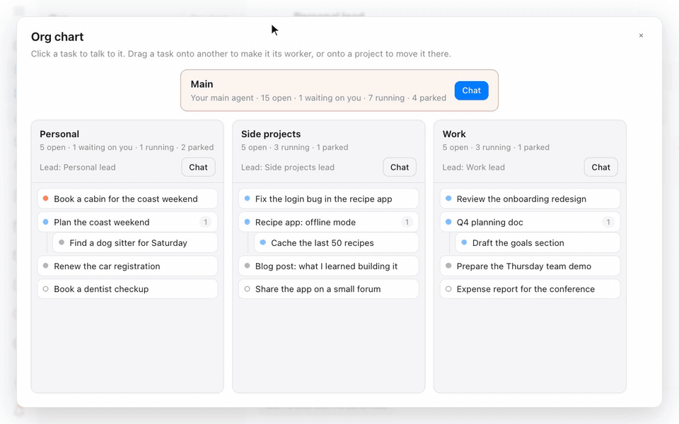

<p align="center"><sub><b>KULLANAN MÜHENDİSLERİN BULUNDUĞU ŞİRKETLER</b></sub></p>
<p align="center">
  <picture>
    <source media="(prefers-color-scheme: dark)" srcset="docs/assets/logo-amazon-white.svg" />
    
  </picture>
  &nbsp;&nbsp;&nbsp;&nbsp;&nbsp;&nbsp;
  <picture>
    <source media="(prefers-color-scheme: dark)" srcset="docs/assets/logo-doordash-white.svg" />
    
  </picture>
</p>

Organizasyonun yanında görevleriniz, Markdown notlarınız, takviminiz ve uzun süreli belleğiniz yer alır; her
kodlama oturumu da aynı web sayfasındadır: Claude Code, Codex, Gemini, OpenCode ve Goose; dizüstü
bilgisayarınızda veya SSH üzerinden uzak bir geliştirme makinesinde. Eklentiler kendi uygulamalarınızı ekler. Open Walnut
kendi sunucunuzda barındırılır, yerel önceliklidir, MIT lisanslıdır ve telemetri içermez.

## Open Walnut Neler Yapar

- **İşinizi yürüten bir organizasyon**: CEO ajanı her projeyi görür. Her projenin
  işi planlayan ve çalışanlara dağıtan bir lideri vardır; her çalışan kendi Claude Code
  oturumudur. Org sayfası neyin size ihtiyacı olduğunu gösterir ve sorunun beklediği yerde
  yanıt verirsiniz.
- **Kişisel Yapay Zeka**: hızlı bir soru sorun veya görevleri yönetmesini, bilgi bulmasını, not yazıp
  aramasını, kodlama oturumları başlatmasını ve zamanlanmış rutinleri çalıştırmasını sağlayın.
- **Claude Code çalışma alanı**: Birden fazla Claude Code oturumunu canlı çıktı, izin kontrolleri,
  terminaller, dosyalar ve oturum geçmişiyle yan yana çalıştırın ve izleyin.
- **Yerel ve uzak oturumlar**: Dizüstü bilgisayarınızdaki ve yapılandırılmış herhangi bir SSH sunucusundaki
  oturumlar için aynı web uygulamasını kullanın.
- **Dayanıklı oturumlar**: Oturumlar tarayıcı bağlantısı koptuğunda, SSH bağlantısı düştüğünde ve
  Walnut sunucusu yeniden başlatıldığında çalışmaya devam eder.
- **Her kodlama ajanı**: Varsayılan olarak Claude Code; ayrıca aynı sütunlarda Codex, Gemini, OpenCode
  ve Goose oturumları (önce bunların CLI'larını kurun).
- **Değişiklik incelemesi**: Oturum başına diff'i inceleyin, tek tek satırlara yorum yapın ve incelemeyi
  aynı oturuma geri gönderin.
- **Görevler ve projeler**: İşi `Project -> Folder -> Task -> Subtask` biçiminde düzenleyin; bir projeye
  ait olmayan görevler için bir Gelen Kutusu (Inbox) bulunur.
- **Notlar ve bellek**: Wiki bağlantılarıyla Markdown notları tutun ve bunları görev, oturum ve bellek
  verileriyle birlikte arayın.
- **Yerel öncelikli depolama**: Temel veriler `~/.open-walnut/` altında JSON, YAML, Markdown ve SQLite
  dosyalarında saklanır.

## Hızlı Başlangıç

### Gereksinimler

- arm64 veya x64 üzerinde macOS 12 veya üzeri ya da glibc 2.28 veya üzeri Linux. Walnut çalıştığı her şeyi
  beraberinde taşır: tek satırlık kurucu, Homebrew ve Mac uygulaması önceden hiçbir şey gerektirmez; npm
  paketi ise Node 22 veya üzerini gerektirir. Alpine (musl) derlemeleri 0.6.19 sonrasındaki sürümle başlar;
  orada önce C++ çalışma zamanını ekleyin: `apk add libstdc++ libgcc`.
- Yalnızca aşağıdaki kaynaktan çalıştırma yolu için git ve [Bun](https://bun.sh) 1.4.4 veya üzeri, başka bir şey gerekmez (git: macOS'ta `xcode-select --install`, Ubuntu'da `sudo apt install git`; Bun: `curl -fsSL https://bun.sh/install | bash`)
- Bir kez oturum açılmış [Claude Code](https://docs.anthropic.com/en/docs/claude-code) (`curl -fsSL https://claude.ai/install.sh | bash`, ardından `claude` çalıştırın)

Tüm yapay zeka kurulumu bundan ibarettir. Walnut'un çalıştırdığı her yapay zeka turu bir Claude Code oturumudur: Hızlı soru (Walnut ajanı), kodlama oturumlarınız, zamanlanmış rutinler ve bir oturum kancasının (hook) gönderdiği ajanların tümü zaten sahip olduğunuz `claude` kurulumunu nasıl oturum açtıysa öyle kullanır (Anthropic hesabı, Bedrock veya Vertex). Anthropic API anahtarı veya AWS Bedrock kimlik bilgileri isteğe bağlıdır ve yalnızca küçük tekil çağrıların (oturum başlıkları, özetler, ses temizleme, hızlı ayrıştırmalar) nereye gideceğini değiştirir: varsayılan olarak bunlar da Claude Code oturumunuz üzerinden gider ve Settings › Advanced › API provider bunları bir sağlayıcıya yönlendirir.

### Kurulum

macOS veya Linux'ta tek komut. Önceden hiçbir şey kurulu olması gerekmez, Node bile:

```bash
curl -fsSL https://github.com/EvanZhang008/open-walnut/releases/latest/download/install.sh | sh
~/.local/bin/walnut web
```

`~/.local/bin` henüz PATH'inizde değilse (macOS'ta varsayılan olarak değildir), betik bunu kabuğunuzun
rc dosyasına (`~/.zshrc`, `~/.bash_profile` veya `~/.bashrc`, fish için `conf.d`, aksi halde `~/.profile`)
ekler ve bildirir; böylece yeni bir terminal doğrudan `walnut web` çalıştırabilir. Kurulumu yaptığınız terminal
eski PATH'ini korur, bu yüzden yukarıdaki komut tam yolu kullanır. `OPEN_WALNUT_MODIFY_PATH=0` rc dosyalarınıza dokunmaz.

Makineniz için en yeni sürüm arşivini indirir, sürümün `SHA256SUMS` dosyasına göre doğrular,
`~/.local/share/open-walnut/app` içine açar (0.6.19 kendi Node'unu orada taşır) ve `walnut` ikili dosyasını
`~/.local/bin` içine bağlar. Tekrar çalıştırmak bu kurulumu en yeni sürümle değiştirir. 0.6.19 sonrasındaki
sürümden itibaren her sürüm kendi klasörüne kurulur ve bir önceki geri alma için saklanır
([Başlangıç](GETTING_STARTED.md#updating-and-rolling-back)).

Homebrew ile:

```bash
brew install evanzhang008/tap/open-walnut
walnut web
```

Mac'te uygulama:
[Apple silicon](https://github.com/EvanZhang008/open-walnut/releases/latest/download/Walnut-arm64.dmg)
veya [Intel](https://github.com/EvanZhang008/open-walnut/releases/latest/download/Walnut-x64.dmg) için indirin
ya da `brew install --cask evanzhang008/tap/walnut` ile kurun. Walnut'u içinde taşır, bu nedenle ilk
başlatmada indirme yapmadan Walnut'u `~/.local/share/open-walnut` içine kurar ve kendini güncel tutar:
yeni bir sürüm arka planda indirilir ve "Restart to update" üzerine tıklandığında kurulur.

npm ile (Node 22 veya üzeri):

```bash
npm install -g open-walnut
open-walnut web
```

Walnut'un kendisi üzerinde çalışmak için bunun yerine bir kopyadan çalıştırın:

```bash
git clone https://github.com/EvanZhang008/open-walnut.git
cd open-walnut
bun install
bun run start
```

[http://localhost:3456](http://localhost:3456) adresini açın. Walnut oturumlarınızı Claude Code ile çalıştırır:
kurulu ve oturum açılmışsa hemen başlayabilirsiniz; aksi halde görev panelinin altındaki System attention
bölümü kurmayı teklif eder ve nasıl oturum açılacağını gösterir. İlk başlatma arka planda varsayılan yerel
gömme (embedding) modeli Qwen3-Embedding-0.6B'yi (yaklaşık 640 MB) ve Apple silicon ile Linux'ta yerel ses
modeli Qwen3-ASR'yi (makineye göre boyutlandırılmış yaklaşık 1 ila 2,5 GB) indirir.

Sağlayıcı seçenekleri, uzak sunucular ve sorun giderme için
[Başlangıç](GETTING_STARTED.md) belgesine bakın.

### Güncelleme

Walnut günde bir kez npm'de daha yeni bir sürüm olup olmadığını kontrol eder ve bunu bildirim panelinde
(System) ile Settings'in altında, kurulumunuzu güncelleyen tek komutla gösterir. Yeniden başlatmak güncellemeyi
uygular: `walnut web` başlamadan önce yayınlanmış daha yeni sürümü kurulduğu yolla kurar (tek satırlık
kurucunun sonraki sürümü mevcut olanın yanına gider, npm kurulumu npm üzerinden günceller);
Settings > General > `Install updates on start`, `config.yaml` içindeki `updates.auto: false` veya
`WALNUT_NO_AUTO_UPDATE=1` bunu kapatır. Başlatılamayan yeni bir sürüm otomatik olarak geri alınır ve daha
yenisi çıkana kadar atlanır. `walnut update` aynı işlemi hemen yapar, `walnut update --check` yalnızca raporlar
ve `walnut doctor` aynı satırı içerir. Homebrew `brew upgrade open-walnut` ile, Mac uygulaması kendi
"Restart to update" seçeneğiyle güncellenir. Kaynaktan çalıştırdığınız bir depodan hiçbir zaman güncelleme
istenmez (kendiniz pull edip derleyin) ve `WALNUT_NO_UPDATE_CHECK=1` bu kontrolü kapatır.

İki kanal yayınlanır: `nightly` her altı saatte bir `main` dalında CI'dan geçen en yeni işleme (commit),
`latest` ise her gün bir gündür yayında olan nightly sürümünden yükseltilen etiketli sürümdür.
`npm install -g open-walnut@nightly` kurulumu nightly kanalına geçirir; siz tekrar `@latest` kurana kadar
nightly'yi takip eder.

### Claude Code ile Kurulum

Makinenizde Claude Code zaten yapılandırılmışsa, Open Walnut'u kurmasını ve doğrulamasını isteyebilirsiniz.
Bunu kimliği doğrulanmış bir Claude Code oturumuna yapıştırın:

```text
Set up Open Walnut for me: read and run the skill at
https://github.com/EvanZhang008/open-walnut/blob/main/skills/setup-walnut/SKILL.md
```

Bu beceri mevcut sağlayıcı kurulumunuzu yansıtır, Walnut'u kurar, başlatır ve gerçek bir model isteğiyle
bağlantıyı doğrular. Kesin adımlar için [kurulum becerisini](skills/setup-walnut/SKILL.md) inceleyin.

## Ürün Turu

### CEO ve Her Proje İçin Bir Lider

Org sayfası şirketi yönettiğiniz yerdir. CEO en üste sabitlenmiştir ve altında tüm liderler yer alır;
her liderin satırı ne üzerinde çalıştığını veya size ne sorduğunu gösterir. Organizasyon şeması her projenin
liderini ve altındaki çalışanları gösterir; bir görevi diğerinin üzerine sürüklemek onu o görevin çalışanı yapar.

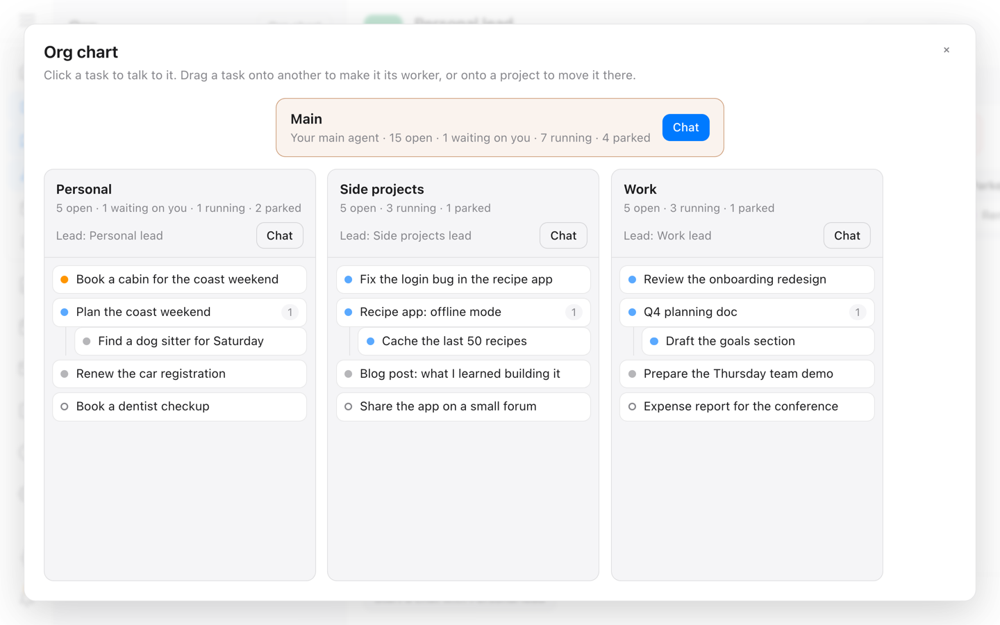

### Çizim Yapan Oturumlar

Zengin mod (Rich mode) varsayılan olarak açıktır: bir oturum metin duvarı yerine bir diyagram, tablo veya
düzenlenmiş bir sayfayla yanıt verebilir ve yanıt aktıkça çizilir.

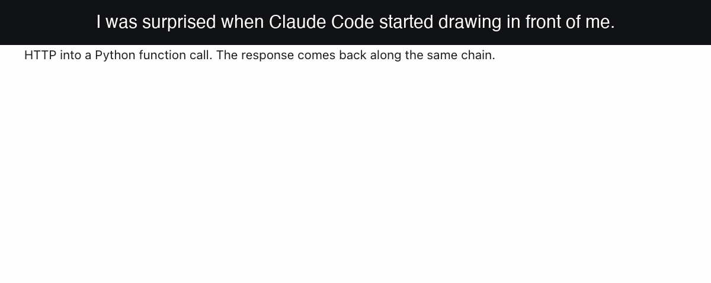

### Bir İstemden Oturum Başlatma

Bir çalışma dizini seçin, işi tanımlayın ve bir Claude Code oturumu başlatın. Çıktı tarayıcıda akarken
görev oturuma bağlı kalır.

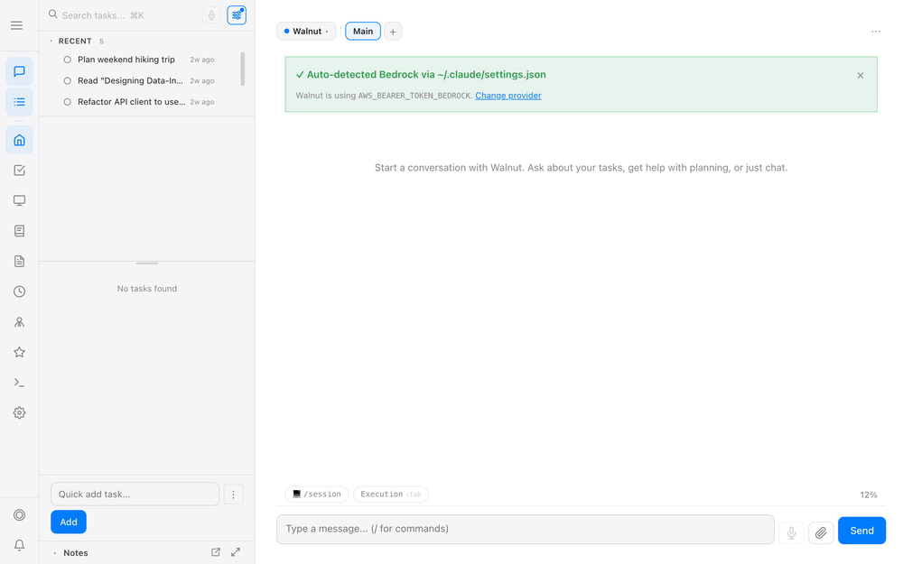

### Tarayıcıdan Claude Code Kullanımı

Sayfadan ayrılmadan Claude Code ile sohbet edin, modunu veya modelini değiştirin, bir terminal açın,
dosyalara göz atın, geçmişi inceleyin ve oturumu çatallayın (fork).

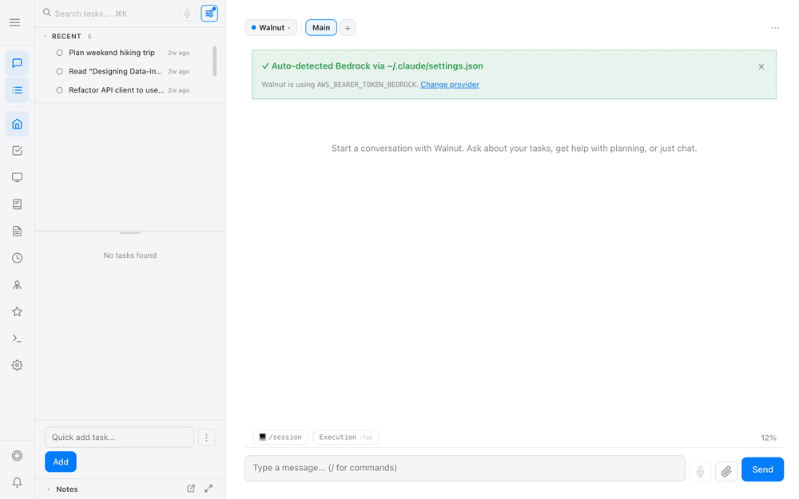

### İşi Tek Görünümde Tutun

Ana sayfa görevleri, Walnut'u ve Claude Code oturum sütunlarını birleştirir. Başka bir uygulamada bağlamı
yeniden kurmadan planlama, yürütme ve inceleme arasında geçiş yapabilirsiniz.


### Etkin İşinizi Belirleyin

Şimdi neyin dikkate ihtiyacı olduğunu, neyin paralel çalışabileceğini ve neyin beklediğini göstermek için
sabitlenmiş görevleri Focus, Satellite ve Parked katmanları arasında taşıyın.


### Notlar ve Bellekte Arama

Wiki bağlantıları ve geri bağlantılarla Markdown notları yazın. Walnut yerel anahtar sözcük ve vektör
dizinleri aracılığıyla notlarda ve bellekte arama yapabilir.

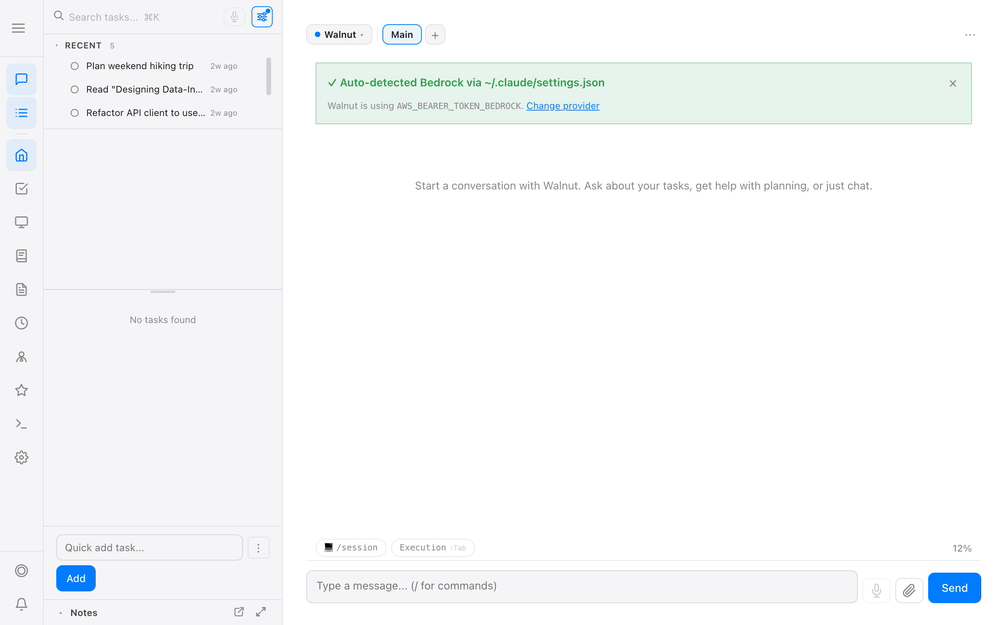

### Oturum Değişikliklerini İnceleyin

Tek bir oturum tarafından düzenlenen dosyaları incelemek için Changed görünümünü açın. Kod seçin veya
satır yorumları bırakın, ardından incelemeyi o oturuma geri gönderin.

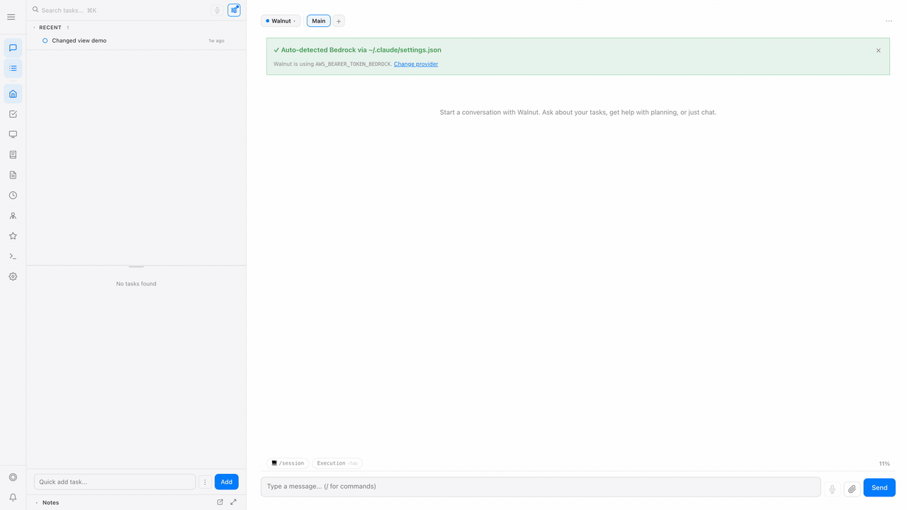

## Yerel ve Uzak Oturumlar

Open Walnut yerel ve uzak çalışmalar için aynı oturum sistemini kullanır. Her sunucudaki küçük bir arka
plan programı uzun süreli Claude Code süreçlerine sahip olurken, web uygulaması bu arka plan programlarına
bağlanır.

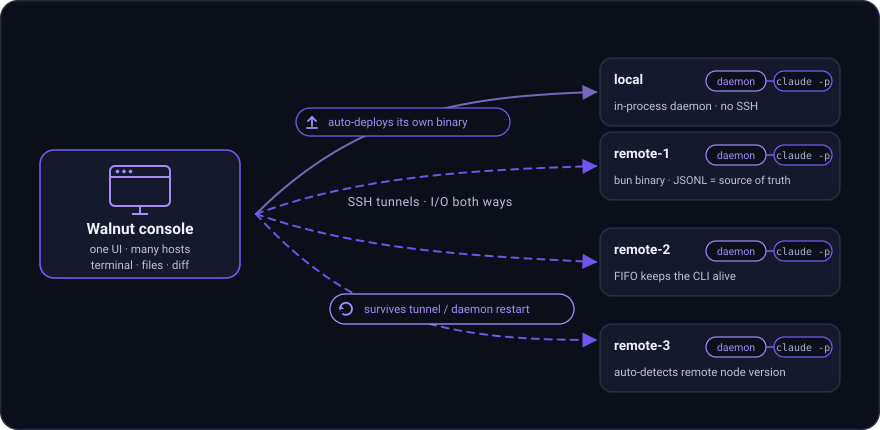

- Tarayıcı, SSH tüneli veya Walnut sunucusu bağlantısı kopsa bile bir oturum çalışmaya devam eder.
- Walnut yeniden bağlandığında mevcut süreci bulur ve diskteki oturum günlüğünden geçmişini geri yükler.
- Walnut arka plan programını SSH üzerinden dağıtır ve günceller. Manuel kopyalama adımı gerekmez.
- Sohbet, terminal erişimi, dosyalar, diff'ler, komutlar ve beceriler uzak sunucularda çalışır.
- Sunucu parolasız SSH ve Claude Code gerektirir; gerisi için [uzak sunucu gereksinimlerine](GETTING_STARTED.md#what-the-remote-host-needs) bakın.

Uzak sunucuları `~/.open-walnut/config.yaml` dosyasına ekleyin:

```yaml
hosts:
  my-server:
    hostname: dev.example.com
    user: myuser
    # İsteğe bağlı: identity_file, port, shell_setup
```

Tam kurulum için [SSH üzerinden uzak oturumlar](GETTING_STARTED.md#remote-sessions-via-ssh) bölümüne bakın.

## Değişiklik İncelemesi ve İş Akışları

Changed görünümü, deponun geçerli Git durumu yerine seçili oturumun kendi geçmişinden bir diff yeniden
oluşturur. Bu, birkaç oturum bir depoyu paylaştığında düzenlemelerin doğru oturuma atfedilmesini sağlar.

- Değişiklikleri bölünmüş (split) veya birleşik (unified) diff olarak görüntüleyin.
- Kod seçin ve oturuma bunun hakkında soru sorun.
- Satır yorumları ekleyin ve tek bir inceleme olarak gönderin.
- Bir oturum birkaç depoda çalıştığında değişiklikleri depoya göre gruplayın.

Open Walnut ayrıca dinamik Claude Code iş akışlarını canlı bir grafik olarak görüntüler. Her düğüm bir
alt ajanın durumunu, modelini, belirteç kullanımını ve süresini gösterir. Dökümünü okumak veya iş akışını
oluşturan betiği incelemek için bir düğümü seçin.

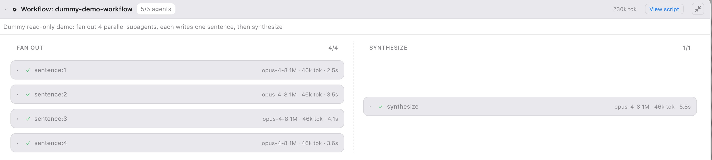

Grafik, yeniden yükleme veya yeniden bağlanma sonrasında diskteki bildiriminden geri yüklenir.

## Görevler, Notlar ve Bellek

### Görevler

Görevler Open Walnut'taki ana çalışma birimidir.

- Projeler ilgili görevleri gruplar; atanmamış görevler Gelen Kutusunda (Inbox) kalır.
- Görevler alt görevler, öncelikler, bitiş tarihleri, bağımlılıklar, etiketler ve notlar içerebilir.
- Oturum etkinliği görev ilerlemesini günceller ve bir lider çalışanlarının işini kontrol ettikten sonra
  görevlerini kapatabilir.
- Görev panosu aramayı, filtreleri, toplu eylemleri ve sürükle-bırak sıralamasını destekler.
- İsteğe bağlı eklentiler Microsoft To-Do ve Jira ile iki yönlü eşitleme sağlar.

### Notlar

Notlar çalışma alanı Markdown, `[[wiki-links]]`, geri bağlantılar, klasörler, ekler, eğik çizgi komutları
ve zengin düzenlemeyi destekler. Notlar `~/.open-walnut/notes/` altında sıradan dosyalar olarak kalır.

Walnut notlarınızda arama yapabilir ve `notes/AGENTS.md` Claude Code oturumlarına paylaşılan yönergeler
sağlayabilir.

### Bellek

Walnut yararlı bağlamı günlük kayıtlara, proje belleğine, depo belleğine ve oturum özetlerine kaydeder.
Arka plandaki bir birleştirme işi konu sayfalarını günceller; böylece her eski konuşmayı yüklemeden önemli
bağlamı bulmak kolay kalır.

Arama; BM25 anahtar sözcük eşleştirmesini, yerel vektör gömmelerini, isteğe bağlı yeniden sıralamayı ve
güncellik ağırlıklandırmasını birleştirir. Bir kaynağın diğerlerini bastırmaması için bellek, notlar,
görevler ve oturumlar ayrı dizinler kullanır.

## Otomasyon ve Uzantılar

- **Rutinler**: Routines sayfasından tek seferlik, aralıklı ve cron tabanlı işler çalıştırın.
- **Özel ajanlar**: Ayrı konuşmalara ve belleğe sahip odaklanmış ajanlar oluşturun.
- **Komutlar ve beceriler**: Web uygulamasından yerel veya uzak Claude Code komutlarına ve becerilerine
  göz atın ve çalıştırın.
- **Görev entegrasyonları**: Yerleşik eklentiler aracılığıyla Microsoft To-Do ve Jira'yı eşitleyin.
- **Özel eklentiler**: Walnut'u değiştirmeden sunucu mantığı, yerel bir React Uygulaması, Araçlar, Beceriler,
  Komutlar, Kancalar, Ajanlar, Sağlayıcılar, rotalar ve görev eşitlemesi ekleyen güvenilir Git veya npm
  Eklentileri kurun.
- **Bildirimler**: Gelen kutusu ve iPhone uygulamasındaki anlık bildirimler, bir görev size ihtiyaç
  duyduğunda haber verir.

### Eklenti yazma

Bir eklenti Uygulaması Walnut'un kendi ekranlarıyla aynı Uygulama Kayıt Defterine katılır; böylece tek bir
`walnut.ui.app` kaydı ona bir Kenar Çubuğu girdisi, `/apps/<plugin-id>~<app-id>` rotası, derin bağlantılar,
bir rozet ve bir Komut Paleti girdisi verir. Bir eklenti kurmak koduna güvenmek anlamına gelir: bir sunucu
girdisi Walnut içinde tam kod olarak çalışır ve yerel bir web girdisi konsolun React ağacını paylaşır.

İlk geliştirme döngüsü tek komuttur; iskelet oluşturur, çalışan konsola bağlar ve her kayıtta yeniden yükler.
Geliştirici paketleri henüz npm'de değildir, bu nedenle bu deponun bir kopyasından çalıştırın:

```bash
bun run build:plugins
bun packages/plugin-cli/dist/cli.js new my-plugin --dev --no-install
```

Paketler yayınlandığında aynı döngü `npx @open-walnut/plugin-cli new my-plugin --dev` olacaktır.

Tam kılavuz için [Eklenti geliştirme](docs/reference/plugin-development.md) belgesini ve her genel yeteneğin
çalıştırılabilir bir örneği için [examples/plugins/walnut-demo](examples/plugins/walnut-demo) (Walnut Eklenti Demosu)
örneğini okuyun. Konsol ayrıca `/plugins/new` adresinde rehberli bir katılım sayfası sunar.

## iOS Eşlikçisi

Beta SwiftUI uygulaması bir iPhone'dan görevlere, notlara ve canlı oturumlara erişim sağlar.
Henüz App Store'da değildir: [`ios-native/`](ios-native/README.md) içinden Xcode ile derleyin.
Web uygulamasıyla QR kodu ile eşleşir ve QR, telefondan gelen her isteğin gönderdiği cihaz belirtecini taşır.
Telefon makinenize üç yoldan ulaşabilir ve tek eşleşme hepsini kapsar: aynı Wi-Fi, bir [Tailscale](https://tailscale.com)
tailnet'i (Settings › Phones & Cloud makineye ve telefona adım adım Tailscale kurulumunda yol gösterir ve
bir Tailscale QR kodu sunar; bu, makine açıkken her yerden, ek sunucu çalıştırmadan çalışır) veya makine
uykudayken de yanıt veren isteğe bağlı kendi barındırdığınız bulut eşlikçisi. Uygulama bir kez bağlandıktan
sonra her adresi öğrenir ve yanıt veren en iyi adrese geçer.

<p align="center">
  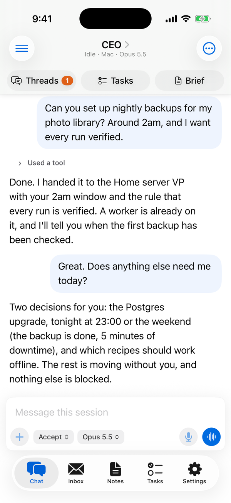
  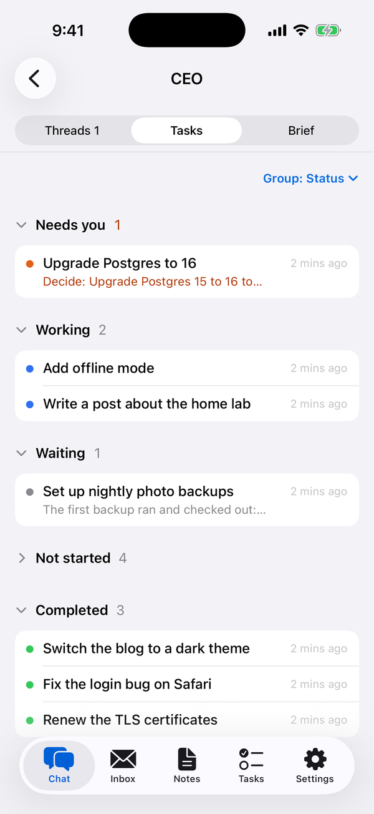
  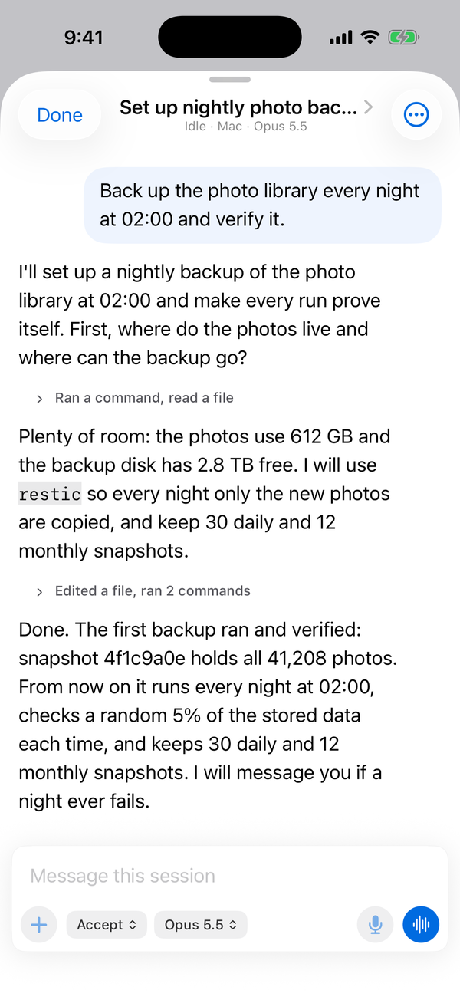
  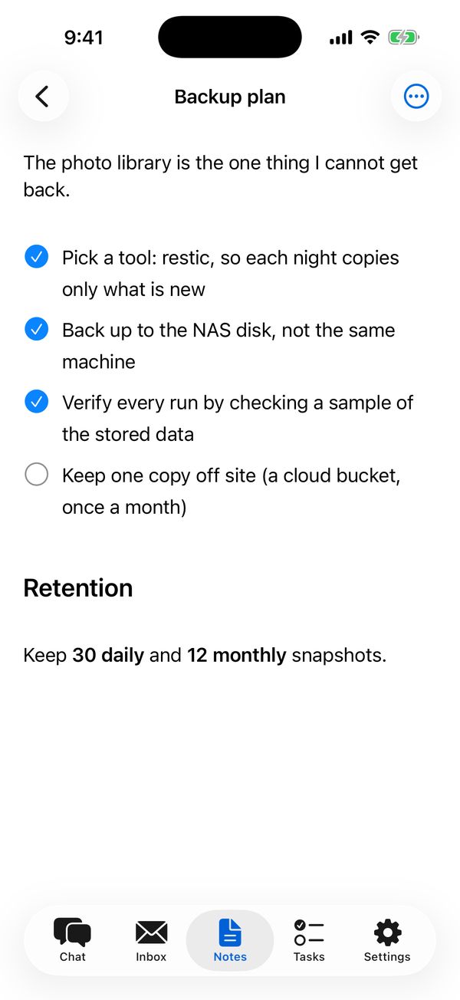
</p>

Geçişin nasıl çalıştığı için [Telefon bağlantı yolları](docs/reference/phone-connection-routes.md) ve
eşlikçi için [Bulut eşitleme](docs/reference/cloud-sync.md) belgelerine bakın.

## Veri ve Gizlilik

- Temel uygulama verileri yerel olarak `~/.open-walnut/` altında saklanır.
- Sunucu kimlik bilgisi olmadan yalnızca üzerinde çalıştığı makineye yanıt verir. Aynı Wi-Fi üzerindeki
  bir cihaz dahil başka herhangi bir cihaz, eşleştirilmiş bir cihaz belirteci gerektirir. Başka bir
  bilgisayardan portu SSH üzerinden yönlendirin (`ssh -L 3456:localhost:3456 <host>`). Walnut önündeki
  bir ters vekil sunucu `X-Forwarded-For` göndermelidir.
- Open Walnut telemetri içermez veya Open Walnut hesabı gerektirmez.
- Model istemleri yalnızca yapılandırdığınız sağlayıcıya gönderilir.
- Uzak oturumlar yalnızca yapılandırdığınız sunuculara bağlanır.
- Bulut erişimi, görev entegrasyonları ve Git uzak depoları isteğe bağlıdır.
- Özel eklentiler deponun dışında kalır.

## Web Sayfaları

| Rota | Amaç |
|---|---|
| `/` | Walnut, görevler ve Claude Code oturum sütunları |
| `/org` | Organizasyon şemasıyla birlikte CEO ve proje liderleri |
| `/tasks` | Proje ve görev çalışma alanı |
| `/tasks/:id` | Görev ayrıntıları, alt görevler, oturumlar, notlar ve bağımlılıklar |
| `/notes` | Markdown notlar çalışma alanı |
| `/memory` | Bellek tarayıcısı |
| `/calendar` | Takvim görünümü |
| `/routines` | Zamanlanmış rutinler ve otomasyon |
| `/agents` | Özel ajanlar ve konuşmaları |
| `/commands` | Claude Code komutları |
| `/skills` | Claude Code ve Walnut becerileri |
| `/settings` | Sağlayıcı, görevler, oturumlar, ses, entegrasyonlar, kullanım ve uygulama ayarları |
| `/apps/<plugin-id>~<app-id>` | Uygulama Kayıt Defteri tarafından bağlanan bir eklenti Uygulaması |

Oturumlar ana sayfada sütunlar olarak açılır. Eski `/sessions?id=...` bağlantıları otomatik olarak oraya yönlendirilir.

Walnut'un kendi ekranları ve her eklenti Uygulaması tek bir Uygulama Kayıt Defterinde yaşar; bu nedenle aynı
Kenar Çubuğu sırasını, görünürlüğü, rozetleri ve gezinmeyi paylaşırlar. Home'un Chat, Todo ve Agenda
öğeleri ayrı uygulamalar değil, Home içindeki Dock kontrolleridir.

## CLI

Hem `walnut` hem de `open-walnut` aynı CLI'yı çağırır.

```bash
walnut web [--port 3456]             # Web uygulamasını başlat
walnut add "Task title" --project X  # Görev oluştur
walnut tasks [--status todo]         # Görevleri listele
walnut projects                      # Projeleri listele
walnut done <id>                     # Bir görevi tamamla
walnut sessions                      # Oturumları listele
walnut start <task_id>               # Bir Claude Code oturumu başlat
walnut recall "query"                 # Bellek ve görevlerde ara
walnut tools list                    # Oturumların ve ajanların çağırdığı işlemleri listele
walnut tools call <op> '{json}'      # Tek bir işlemi çalıştır ve JSON sonucunu yazdır
walnut logs [-f] [--json]            # Yapılandırılmış günlükleri oku
```

Sohbet alt komutu yoktur: `claude` terminal REPL'dir ve `walnut tools call` tek seferlik çağrıdır.

Tüm komutlar ve seçenekler için `walnut --help` kullanın.

## Yapılandırma

Yapılandırma `~/.open-walnut/config.yaml` içinde saklanır. Settings sayfası model sağlayıcılarını,
aramayı, entegrasyonları, depoları, oturum sunucularını, kullanımı ve diğer uygulama seçeneklerini kapsar.

Open Walnut; Anthropic, AWS Bedrock, OpenAI uyumlu API'ler, Google Generative AI ve Ollama'yı destekler.
Sağlayıcı örnekleri için [Başlangıç](GETTING_STARTED.md#provider-configuration-optional) belgesine bakın.

## Proje Yapısı

```text
src/
  model/          # Tekli model çağrıları, sağlayıcı bağdaştırıcıları ve model kataloğu
  ops/            # Hem oturumların hem de CLI'nın çağırdığı işlem kayıt defteri
  commands/       # CLI komutları
  core/           # Görevler, bellek, arama, oturumlar, rutinler ve yapılandırma
  integrations/   # Yerleşik görev entegrasyonları
  logging/        # Yapılandırılmış günlükleme ve sansürleme
  providers/      # Claude Code oturumları, arka plan programları ve alt ajanlar
  web/            # Express sunucusu, REST API ve WebSocket işleyicileri
web/              # React web uygulaması
ios-native/       # SwiftUI eşlikçi uygulaması
infra/            # İsteğe bağlı bulut eşlikçi altyapısı
docs/             # Tasarım, kararlar, incelemeler ve başvurular
tests/            # Birim, entegrasyon, uçtan uca ve tarayıcı testleri
```

Sistem tasarımı için [Mimari](ARCHITECTURE.md) belgesini ve daha derin teknik belgeler için
[belge dizinini](docs/README.md) okuyun.

## Geliştirme

Bir kopya Bun ile kurulur: `bun install`, `bun.lock` (ve `web/bun.lock`) içindeki kesin sürümleri kurar
ve `patches/` yamalarını uygular. Değişen bir `bun.lock` dosyasını buna neden olan `package.json`
değişikliğiyle birlikte işleyin.

```bash
bun install                         # Bağımlılıkları kur (kök ve web/)
bun run build                       # Sunucuyu ve oturum arka plan programını derle
cd web && bun x vite build          # Web uygulamasını derle
bun run dev                         # Sunucuyu izle
cd web && bun x vite                # Web uygulamasını sıcak yeniden yüklemeyle çalıştır
bun run test:quick                  # Varsayılan hızlı test paketini çalıştır
bun run test:focus -- <test-path>   # Odaklanmış testleri çalıştır
bun run lint                        # Sunucuyu tip denetiminden geçir
```

Arka uç geliştirme sunucusu ve Vite birlikte şu komutla da başlatılabilir:

```bash
bun run web:dev
```

## Teknoloji Yığını

- Bun, Express, TypeScript ve SQLite
- React, Vite ve TypeScript
- Anthropic Claude ve diğer yapılandırılabilir model sağlayıcıları
- Stream-JSON G/Ç ile Claude Code CLI
- Yerleşik hibrit arama: SQLite FTS5 anahtar sözcük katmanları + yerel vektör yeniden puanlama
- Vitest ve Playwright

## Yıldız Geçmişi

[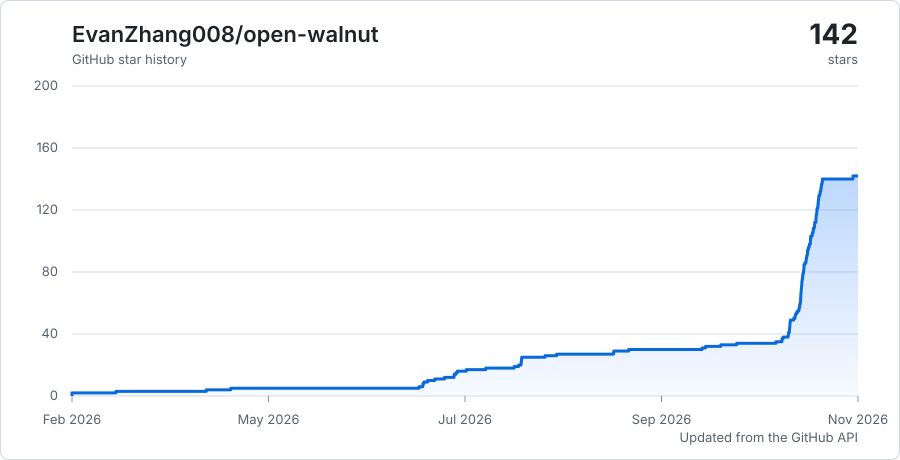](https://github.com/EvanZhang008/open-walnut/stargazers)

## Katkıda Bulunma

Katkılarınızı bekliyoruz. Bir pull request açmadan önce [CONTRIBUTING.md](CONTRIBUTING.md) dosyasını okuyun.

## Dost Bağlantılar

[LINUX DO](https://linux.do)

## Lisans

[MIT](LICENSE)
