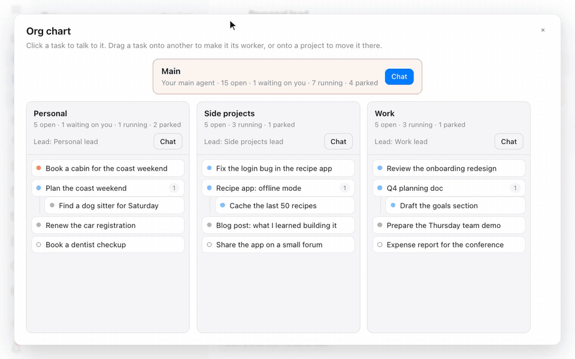
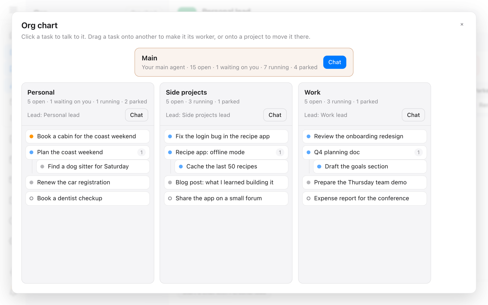
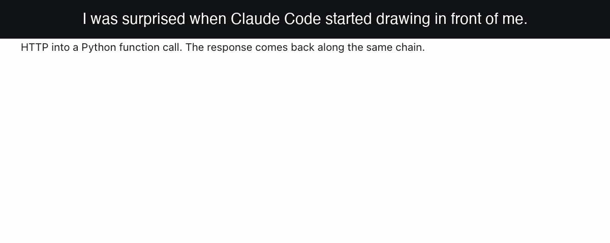
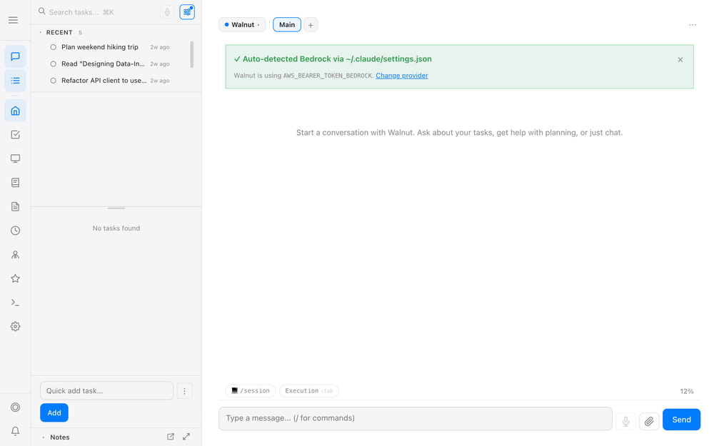
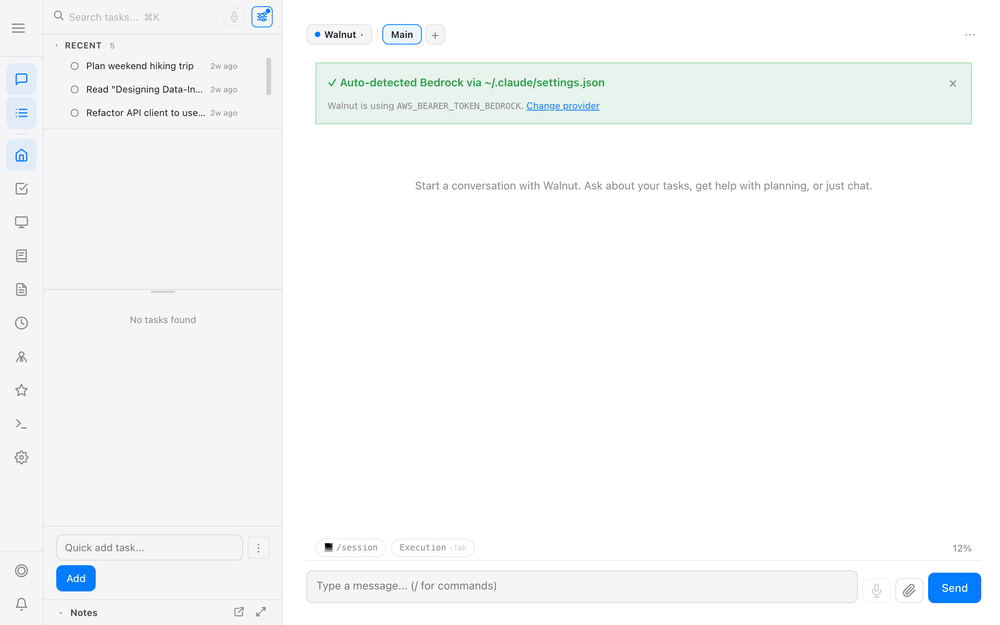
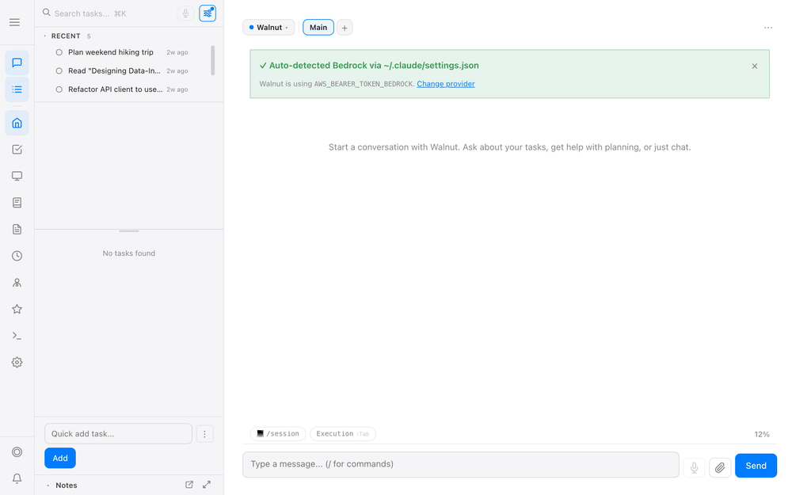
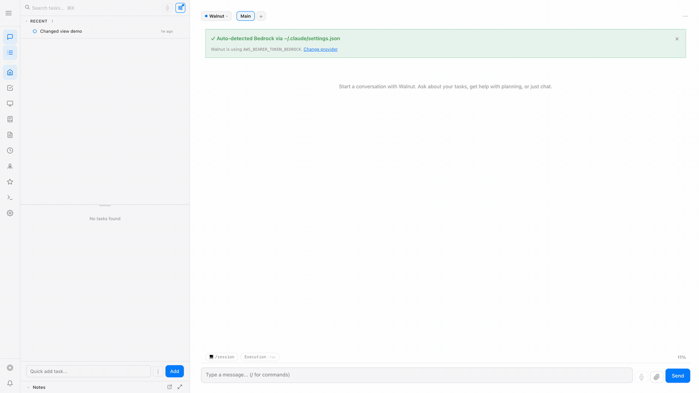
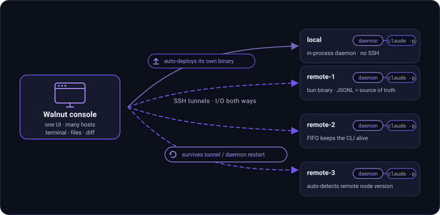
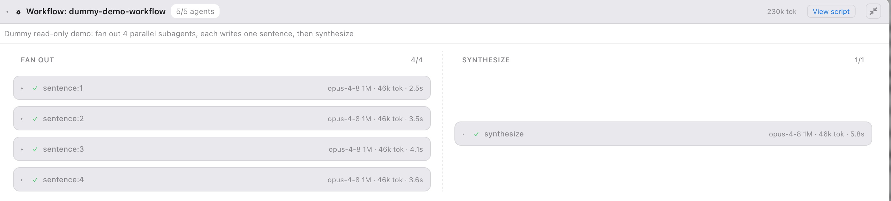
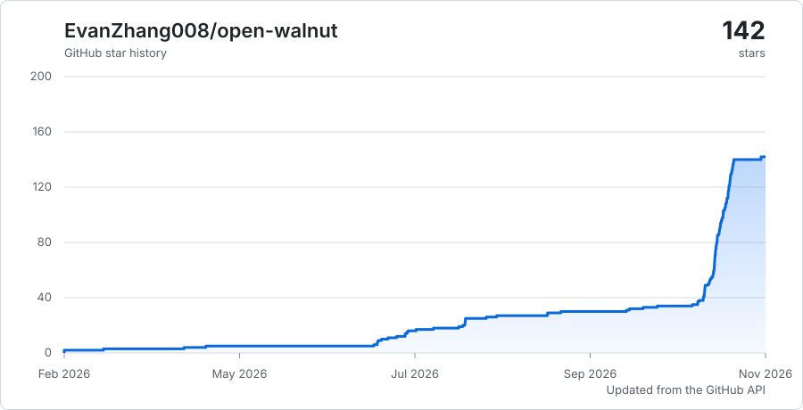

[English](./README.md) | [简体中文](./README.zh-CN.md)

# Open Walnut

[](LICENSE)
[](https://github.com/EvanZhang008/open-walnut)

**一个开源应用，用来取代 Notion 和你开的一堆 Claude Code 终端。AI agent 像一家小公司一样替你干活。** 你只和一个 CEO agent 对话，每个项目有自己的 lead，lead 负责运行 Claude Code session 和 worker。

在 macOS 或 Linux 上一行命令安装（不需要预装任何东西，连 Node 也不用），然后打开 [localhost:3456](http://localhost:3456)：

```bash
curl -fsSL https://github.com/EvanZhang008/open-walnut/releases/latest/download/install.sh | sh
~/.local/bin/walnut web
```

也可以用 Homebrew：`brew install evanzhang008/tap/open-walnut && walnut web`，或者下载 Mac app：
[Apple silicon](https://github.com/EvanZhang008/open-walnut/releases/latest/download/Walnut-arm64.dmg) ·
[Intel](https://github.com/EvanZhang008/open-walnut/releases/latest/download/Walnut-x64.dmg)。
Walnut 用 [Claude Code](https://docs.anthropic.com/en/docs/claude-code) 来运行 agent，登录一次即可。



<p align="center"><sub><b>USED BY ENGINEERS AT</b></sub></p>
<p align="center">
  <picture>
    <source media="(prefers-color-scheme: dark)" srcset="docs/assets/logo-amazon-white.svg" />
    
  </picture>
  &nbsp;&nbsp;&nbsp;&nbsp;&nbsp;&nbsp;
  <picture>
    <source media="(prefers-color-scheme: dark)" srcset="docs/assets/logo-doordash-white.svg" />
    
  </picture>
</p>

组织旁边是你的任务、Markdown 笔记、日历和长期记忆，所有编码 session 也都在同一个网页里：Claude Code、Codex、Gemini、OpenCode 和 Goose，可以跑在你的笔记本上，也可以通过 SSH 跑在远程开发机上。插件可以加入你自己的应用。Open Walnut 支持自托管，数据优先存在本地，采用 MIT 许可证，没有任何遥测。

## Open Walnut 能做什么

- **替你做事的组织**：CEO agent 能看到所有项目。每个项目有一个 lead，负责规划工作并分给 worker，每个 worker 都是一个独立的 Claude Code session。Org 页面会显示哪些事需要你处理，你可以直接在问题所在的位置回答。
- **Personal AI**：可以问一个简单问题，也可以让它管理任务、查找信息、写笔记和搜索笔记、启动编码 session、运行定时 routine。
- **Claude Code 工作区**：并排运行和监控多个 Claude Code session，有实时输出、权限控制、终端、文件和 session 历史。
- **本地和远程 session**：笔记本上的 session 和任何已配置的 SSH 主机上的 session，用同一个网页应用管理。
- **持久的 session**：浏览器断开、SSH 连接掉线、Walnut 服务重启，session 都会继续运行。
- **所有编码 agent**：默认是 Claude Code，Codex、Gemini、OpenCode 和 Goose 的 session 也放在同样的列里（需要先安装它们的 CLI）。
- **改动评审**：查看每个 session 的 diff，对单独的某一行写评论，再把评审结果发回同一个 session。
- **任务和项目**：按 `Project -> Folder -> Task -> Subtask` 组织工作，不属于任何项目的任务放在 Inbox。
- **笔记和记忆**：用 Markdown 写笔记，支持 wiki 链接，并能和任务、session、记忆数据一起搜索。
- **本地优先存储**：核心数据以 JSON、YAML、Markdown 和 SQLite 文件的形式存放在 `~/.open-walnut/` 下。

## 快速开始

### 环境要求

- macOS 12 或更新版本，或 glibc 2.28 或更新版本的 Linux，架构为 arm64 或 x64。Walnut 自带运行所需的一切：一行命令安装、Homebrew 和 Mac app 都不需要预装任何东西，npm 包需要 Node 22 或更新版本。Alpine (musl) 的构建从 0.6.19 之后的版本开始提供；在 Alpine 上，先安装 C++ 运行库：`apk add libstdc++ libgcc`。
- git 和 [Bun](https://bun.sh) 1.4.4 或更新版本，只有下面"从源码运行"这条路线需要，其他都不用（git：macOS 上 `xcode-select --install`，Ubuntu 上 `sudo apt install git`；Bun：`curl -fsSL https://bun.sh/install | bash`）
- [Claude Code](https://docs.anthropic.com/en/docs/claude-code)，登录一次即可（`curl -fsSL https://claude.ai/install.sh | bash`，然后运行 `claude`）

AI 的配置到这里就结束了。Walnut 运行的每一次 AI 调用都是一个 Claude Code session：Quick question（Walnut agent）、你的编码 session、定时 routine，以及 session hook 派出的 agent，用的都是你已有的 `claude`，不管它怎么登录（Anthropic 账号、Bedrock 或 Vertex）。Anthropic API key 或 AWS Bedrock 凭证是可选的，它们只改变那些小的单次调用去哪里（session 标题、摘要、语音整理、快速解析）：默认情况下这些调用也走你的 Claude Code 登录，在 Settings › Advanced › API provider 里可以把它们指向某个 provider。

### 安装

在 macOS 或 Linux 上一行命令搞定。不需要预装任何东西，连 Node 也不用：

```bash
curl -fsSL https://github.com/EvanZhang008/open-walnut/releases/latest/download/install.sh | sh
~/.local/bin/walnut web
```

如果 `~/.local/bin` 还不在你的 PATH 里（macOS 上默认不在），脚本会把它加到你的 shell 的 rc 文件里（`~/.zshrc`、`~/.bash_profile` 或 `~/.bashrc`，fish 的 `conf.d`，否则是 `~/.profile`），并且会告诉你，这样新开的终端直接运行 `walnut web` 就行。你用来安装的那个终端还是旧的 PATH，所以上面的命令写了完整路径。设置 `OPEN_WALNUT_MODIFY_PATH=0` 可以让它不碰你的 rc 文件。

脚本会下载最新 release 里适合你机器的压缩包，用 release 里的 `SHA256SUMS` 校验，解压到 `~/.local/share/open-walnut/app`（0.6.19 在那里自带 Node），并把 `walnut` 链接到 `~/.local/bin`。再运行一次，会用最新 release 替换当前安装。从 0.6.19 之后的版本开始，每个版本有自己的文件夹，上一个版本会保留下来，方便回滚
（[Getting Started](GETTING_STARTED.md#updating-and-rolling-back)）。

用 Homebrew：

```bash
brew install evanzhang008/tap/open-walnut
walnut web
```

在 Mac 上也可以用 app：下载
[Apple silicon](https://github.com/EvanZhang008/open-walnut/releases/latest/download/Walnut-arm64.dmg)
或 [Intel](https://github.com/EvanZhang008/open-walnut/releases/latest/download/Walnut-x64.dmg) 版本，
或者用 `brew install --cask evanzhang008/tap/walnut` 安装。app 里自带 Walnut，所以第一次启动时会在 `~/.local/share/open-walnut` 里完成设置，不需要下载，并且会自己保持最新：新 release 在后台下载，点 "Restart to update" 后安装。

用 npm（Node 22 或更新版本）：

```bash
npm install -g open-walnut
open-walnut web
```

如果你要开发 Walnut 本身，改用从源码运行：

```bash
git clone https://github.com/EvanZhang008/open-walnut.git
cd open-walnut
bun install
bun run start
```

打开 [http://localhost:3456](http://localhost:3456)。Walnut 用 Claude Code 运行你的 session：如果它已经安装并登录，可以直接开始；否则，任务面板底部的 System attention 会提示你安装，并说明怎么登录。第一次启动时，会在后台下载默认的本地 embedding 模型 Qwen3-Embedding-0.6B（约 640 MB），在 Apple silicon 和 Linux 上还会下载本地语音模型 Qwen3-ASR（约 1 到 2.5 GB，按机器配置选择大小）。

关于 provider 选项、远程主机和问题排查，见 [Getting Started](GETTING_STARTED.md)。

### 更新

Walnut 每天会查一次 npm 上有没有新 release，有的话在通知面板（System）和 Settings 底部显示，并附上更新你这个安装的那一行命令。重启后生效：`walnut web` 会在启动前，按你当初的安装方式装上更新的已发布版本（一行命令安装的下一个版本会放在当前版本旁边，npm 安装则通过 npm 更新）。在 Settings > General 里关闭 `Install updates on start`，或者在 config.yaml 里设置 `updates.auto: false`，或者设置 `WALNUT_NO_AUTO_UPDATE=1`，都可以关掉这个行为。如果新版本启动不了，会自动退回旧版本，并且在出现更新的版本之前跳过它。`walnut update` 会立刻执行同样的更新，`walnut update --check` 只报告不更新，`walnut doctor` 里也有同样的一行信息。Homebrew 用 `brew upgrade open-walnut` 更新，Mac app 用它自己的 "Restart to update"。从源码运行的 checkout 不会提示更新（自己 pull 和构建），设置 `WALNUT_NO_UPDATE_CHECK=1` 可以关掉检查。

发布了两个 channel：`nightly` 是 `main` 上最新一个通过 CI 的 commit，每六小时一次；`latest` 是带 tag 的 release，每天从已经发布满一天的 nightly 里提升而来。`npm install -g open-walnut@nightly` 会把安装切到 nightly channel；之后它会一直跟随 nightly，直到你再次安装 `@latest`。

### 用 Claude Code 来安装

如果你的机器上已经配好了 Claude Code，可以让它来安装并验证 Open Walnut。把下面这段粘贴到一个已登录的 Claude Code session 里：

```text
Set up Open Walnut for me: read and run the skill at
https://github.com/EvanZhang008/open-walnut/blob/main/skills/setup-walnut/SKILL.md
```

这个 skill 会沿用你现有的 provider 配置，安装 Walnut，启动它，并用一次真实的模型请求验证连接。具体步骤见 [setup skill](skills/setup-walnut/SKILL.md)。

## 产品导览

### CEO 和每个项目的 lead

Org 页面是你管理这家"公司"的地方。CEO 固定在最上面，所有 lead 在它下面；每个 lead 那一行会写它正在做什么，或者在问你什么。组织图显示每个项目的 lead 和它手下的 worker，把一个任务拖到另一个任务上，就会让它成为那个任务的 worker。



### 会画图的 session

Rich mode 默认开启：session 可以用图表、表格或排好版的页面来回答，而不是一大段文字，并且在回答流式输出的同时把图画出来。



### 从一段 prompt 启动 session

选一个工作目录，描述要做的事，然后启动一个 Claude Code session。输出在浏览器里流式显示时，任务一直和 session 关联在一起。



### 在浏览器里用 Claude Code

和 Claude Code 对话，切换它的 mode 或模型，打开终端，浏览文件，查看历史，还能 fork session，全程不用离开这个页面。



### 所有工作在一个视图里

首页把任务、Walnut 和 Claude Code session 的列放在一起。规划、执行和评审之间可以直接切换，不用在另一个应用里重新建立上下文。


### 设定当前的工作

把固定的任务在 Focus、Satellite 和 Parked 之间移动，用来表示现在需要关注什么、什么可以并行、什么在等待。


### 搜索笔记和记忆

用 wiki 链接和反向链接写 Markdown 笔记。Walnut 可以通过本地的关键词索引和向量索引搜索笔记和记忆。



### 评审 session 的改动

打开 Changed 视图，查看某一个 session 编辑过的文件。选中代码或在某一行留评论，然后把评审结果发回那个 session。



## 本地和远程 session

Open Walnut 对本地和远程的工作使用同一套 session 系统。每台主机上有一个小 daemon，负责持有长时间运行的 Claude Code 进程，网页应用连接这些 daemon。



- 浏览器、SSH tunnel 或 Walnut 服务断开时，session 会继续运行。
- Walnut 重新连上后，会找到已有的进程，并从磁盘上的 session 日志恢复它的历史。
- Walnut 通过 SSH 部署和更新它的 daemon，不需要手动复制。
- 聊天、终端、文件、diff、命令和 skill 在远程主机上都能用。
- 主机需要免密码 SSH 和 Claude Code；其余要求见 [远程主机需要什么](GETTING_STARTED.md#what-the-remote-host-needs)。

在 `~/.open-walnut/config.yaml` 里添加远程主机：

```yaml
hosts:
  my-server:
    hostname: dev.example.com
    user: myuser
    # Optional: identity_file, port, shell_setup
```

完整的设置见 [Remote sessions via SSH](GETTING_STARTED.md#remote-sessions-via-ssh)。

## 改动评审和 workflow

Changed 视图根据所选 session 自己的历史重建 diff，而不是看仓库当前的 Git 状态。这样当多个 session 共用一个仓库时，每处编辑仍然算在正确的 session 头上。

- 可以用分栏或统一的 diff 查看改动。
- 选中代码，向 session 提问。
- 添加行评论，并作为一次评审一起发送。
- 当一个 session 在多个仓库里工作时，按仓库给改动分组。

Open Walnut 还会把动态的 Claude Code workflow 显示成实时的图。每个节点显示一个 subagent 的状态、模型、token 用量和耗时。选中一个节点，可以读它的 transcript，或者查看创建这个 workflow 的脚本。



页面重新加载或重新连接后，这个图会从磁盘上的 manifest 恢复。

## 任务、笔记和记忆

### 任务

任务是 Open Walnut 里工作的基本单位。

- 项目把相关任务分组；没有归属的任务留在 Inbox。
- 任务可以包含子任务、优先级、截止日期、依赖、标签和笔记。
- session 的活动会更新任务进度，lead 检查过 worker 的工作后，可以关闭 worker 的任务。
- 任务看板支持搜索、过滤、批量操作和拖拽排序。
- 可选插件提供与 Microsoft To-Do 和 Jira 的双向同步。

### 笔记

笔记工作区支持 Markdown、`[[wiki-links]]`、反向链接、文件夹、附件、斜杠命令和富文本编辑。笔记仍然是 `~/.open-walnut/notes/` 下的普通文件。

Walnut 可以搜索你的笔记，`notes/AGENTS.md` 可以给 Claude Code session 提供共用的指令。

### 记忆

Walnut 会把有用的上下文记录在每日日志、项目记忆、仓库记忆和 session 摘要里。一个后台整理任务会更新主题页面，这样重要的上下文容易找到，而不用加载每一段旧对话。

搜索结合了 BM25 关键词匹配、本地向量 embedding、可选的重排序和新近度加权。记忆、笔记、任务和 session 使用各自独立的索引，这样一种来源不会压过其他来源。

## 自动化和扩展

- **Routines**：在 Routines 页面运行一次性、按间隔和基于 cron 的任务。
- **自定义 agent**：创建专注的 agent，每个有独立的对话和记忆。
- **命令和 skill**：在网页应用里浏览并运行本地或远程的 Claude Code 命令和 skill。
- **任务集成**：通过内置插件同步 Microsoft To-Do 和 Jira。
- **自定义插件**：安装可信的 Git 或 npm 插件，可以添加服务端逻辑、原生 React App、Tool、Skill、Command、Hook、Agent、Provider、路由和任务同步，不需要改动 Walnut 本身。
- **通知**：收件箱和 iPhone app 上的推送通知，会在有任务需要你时告诉你。

### 编写插件

插件的 App 和 Walnut 自己的页面加入同一个 App Registry，所以一次 `walnut.ui.app` 注册就能得到侧边栏入口、路由 `/apps/<plugin-id>~<app-id>`、深链接、角标和命令面板入口。安装插件意味着信任它的代码：服务端入口在 Walnut 里以完整权限运行，原生网页入口和控制台共用同一棵 React 树。

第一次开发只要一条命令：它会生成脚手架、链接到正在运行的控制台，并在每次保存时重新加载。作者用的包还没有发布到 npm，所以请在这个仓库的 checkout 里运行：

```bash
bun run build:plugins
bun packages/plugin-cli/dist/cli.js new my-plugin --dev --no-install
```

这些包发布之后，同样的流程会是 `npx @open-walnut/plugin-cli new my-plugin --dev`。

完整指南见 [Plugin development](docs/reference/plugin-development.md)，每一项公开能力的可运行示例见 [examples/plugins/walnut-demo](examples/plugins/walnut-demo)（Walnut Plugin Demo）。控制台还带有一个引导页面，地址是 `/plugins/new`。

## iOS 伴侣 app

这个 beta 版 SwiftUI app 让你在 iPhone 上访问任务、笔记和实时 session。它还不在 App Store 上：请用 Xcode 从 [`ios-native/`](ios-native/README.md) 构建。它通过二维码和网页应用配对，二维码里带着设备 token，手机发出的每个请求都会带上它。手机有三种方式连到你的机器，一次配对对三种都有效：同一个 Wi-Fi；[Tailscale](https://tailscale.com) tailnet（Settings › Phones & Cloud 会一步一步带你在机器和手机上安装 Tailscale，并提供 Tailscale 二维码；只要机器开着，在任何地方都能用，不需要自己运行服务器）；或者可选的自托管 cloud companion，它在机器休眠时也能响应。app 连接成功一次后会学到所有地址，并切换到能连通的最佳地址。

切换的原理见 [Phone connection routes](docs/reference/phone-connection-routes.md)，companion 见 [Cloud sync](docs/reference/cloud-sync.md)。

## 数据和隐私

- 核心应用数据存放在本地的 `~/.open-walnut/` 下。
- 服务只对它所在的那台机器免凭证响应。任何其他设备，包括同一个 Wi-Fi 下的设备，都需要已配对的设备 token。从另一台电脑访问时，用 SSH 转发端口（`ssh -L 3456:localhost:3456 <host>`）。放在 Walnut 前面的反向代理必须发送 `X-Forwarded-For`。
- Open Walnut 没有遥测，也不需要 Open Walnut 账号。
- 模型 prompt 只会发给你配置的 provider。
- 远程 session 只连接你配置的主机。
- 云访问、任务集成和 Git remote 都是可选的。
- 私有插件放在仓库之外。

## 网页页面

| Route | 用途 |
|---|---|
| `/` | Walnut、任务和 Claude Code session 的列 |
| `/org` | CEO 和各项目的 lead，以及组织图 |
| `/tasks` | 项目和任务工作区 |
| `/tasks/:id` | 任务详情、子任务、session、笔记和依赖 |
| `/notes` | Markdown 笔记工作区 |
| `/memory` | 记忆浏览器 |
| `/calendar` | 日历视图 |
| `/routines` | 定时 routine 和自动化 |
| `/agents` | 自定义 agent 和它们的对话 |
| `/commands` | Claude Code 命令 |
| `/skills` | Claude Code 和 Walnut 的 skill |
| `/settings` | Provider、任务、session、语音、集成、用量和应用设置 |
| `/apps/<plugin-id>~<app-id>` | 由 App Registry 挂载的插件 App |

Session 在首页以列的形式打开。旧的 `/sessions?id=...` 链接会自动跳转到首页。

Walnut 自己的页面和每个插件 App 都在同一个 App Registry 里，所以它们共用同样的侧边栏顺序、可见性、角标和导航。首页的 Chat、Todo 和 Agenda 是首页内部的 Dock 控件，不是单独的 app。

## CLI

`walnut` 和 `open-walnut` 调用的是同一个 CLI。

```bash
walnut web [--port 3456]             # Start the web app
walnut add "Task title" --project X  # Create a task
walnut tasks [--status todo]         # List tasks
walnut projects                      # List projects
walnut done <id>                     # Complete a task
walnut sessions                      # List sessions
walnut start <task_id>               # Start a Claude Code session
walnut recall "query"                 # Search memory and tasks
walnut tools list                    # List the operations sessions and agents call
walnut tools call <op> '{json}'      # Run one operation and print its JSON result
walnut logs [-f] [--json]            # Read structured logs
```

没有 chat 子命令：`claude` 是终端里的 REPL，`walnut tools call` 是一次性调用。

用 `walnut --help` 查看所有命令和选项。

## 配置

配置存放在 `~/.open-walnut/config.yaml`。Settings 页面涵盖模型 provider、搜索、集成、仓库、session 主机、用量和其他应用选项。

Open Walnut 支持 Anthropic、AWS Bedrock、兼容 OpenAI 的 API、Google Generative AI 和 Ollama。provider 的示例见 [Getting Started](GETTING_STARTED.md#provider-configuration-optional)。

## 项目结构

```text
src/
  model/          # Single model calls, provider adapters, and the model catalog
  ops/            # The operation registry sessions and the CLI both call
  commands/       # CLI commands
  core/           # Tasks, memory, search, sessions, routines, and config
  integrations/   # Built-in task integrations
  logging/        # Structured logging and redaction
  providers/      # Claude Code sessions, daemons, and subagents
  web/            # Express server, REST API, and WebSocket handlers
web/              # React web app
ios-native/       # SwiftUI companion app
infra/            # Optional cloud companion infrastructure
docs/             # Design, decisions, investigations, and references
tests/            # Unit, integration, end-to-end, and browser tests
```

系统设计见 [Architecture](ARCHITECTURE.md)，更深入的技术文档见 [documentation index](docs/README.md)。

## 开发

checkout 用 Bun 安装：`bun install` 会安装 `bun.lock`（和 `web/bun.lock`）里的确切版本，并应用 `patches/`。改动过的 `bun.lock` 要和引起这个改动的 `package.json` 一起提交。

```bash
bun install                         # Install dependencies (root and web/)
bun run build                       # Build the server and session daemon
cd web && bun x vite build          # Build the web app
bun run dev                         # Watch the server
cd web && bun x vite                # Run the web app with hot reload
bun run test:quick                  # Run the default fast test suite
bun run test:focus -- <test-path>   # Run focused tests
bun run lint                        # Type-check the server
```

后端开发服务和 Vite 也可以一起启动：

```bash
bun run web:dev
```

## 技术栈

- Bun、Express、TypeScript 和 SQLite
- React、Vite 和 TypeScript
- Anthropic Claude 和其他可配置的模型 provider
- 使用 stream-JSON I/O 的 Claude Code CLI
- 内置的混合搜索：SQLite FTS5 关键词通道加本地向量重排
- Vitest 和 Playwright

## Star History

[](https://github.com/EvanZhang008/open-walnut/stargazers)

## 参与贡献

欢迎贡献。提 pull request 之前，请先阅读 [CONTRIBUTING.md](CONTRIBUTING.md)。

## 友情链接

[LINUX DO](https://linux.do)

## 许可证

[MIT](LICENSE)
